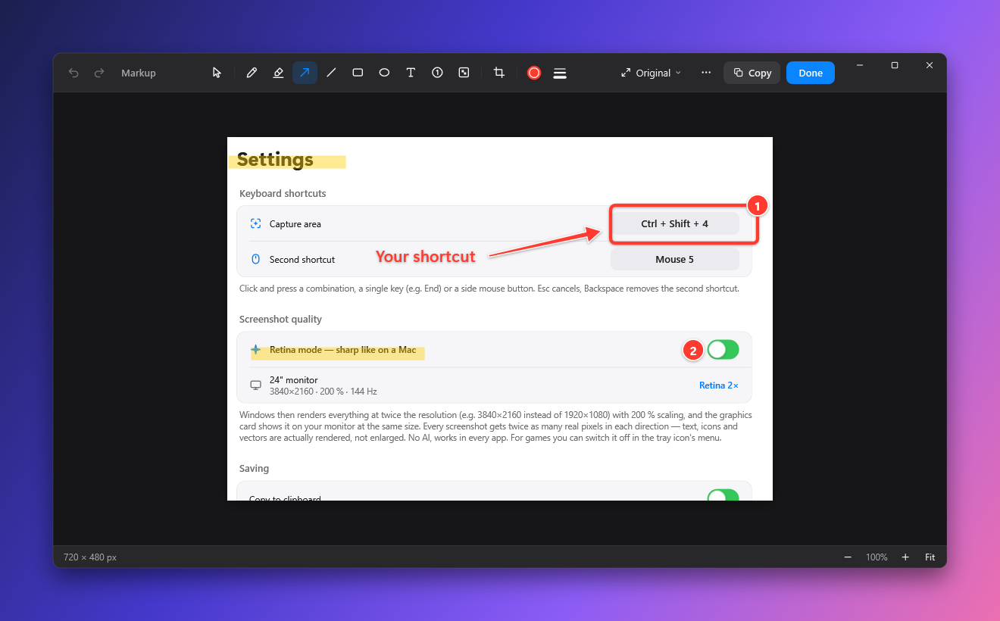
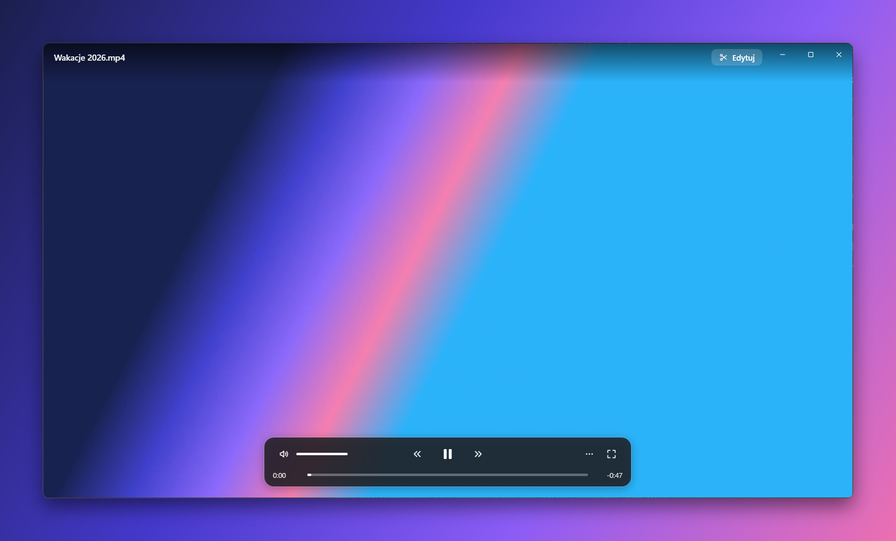
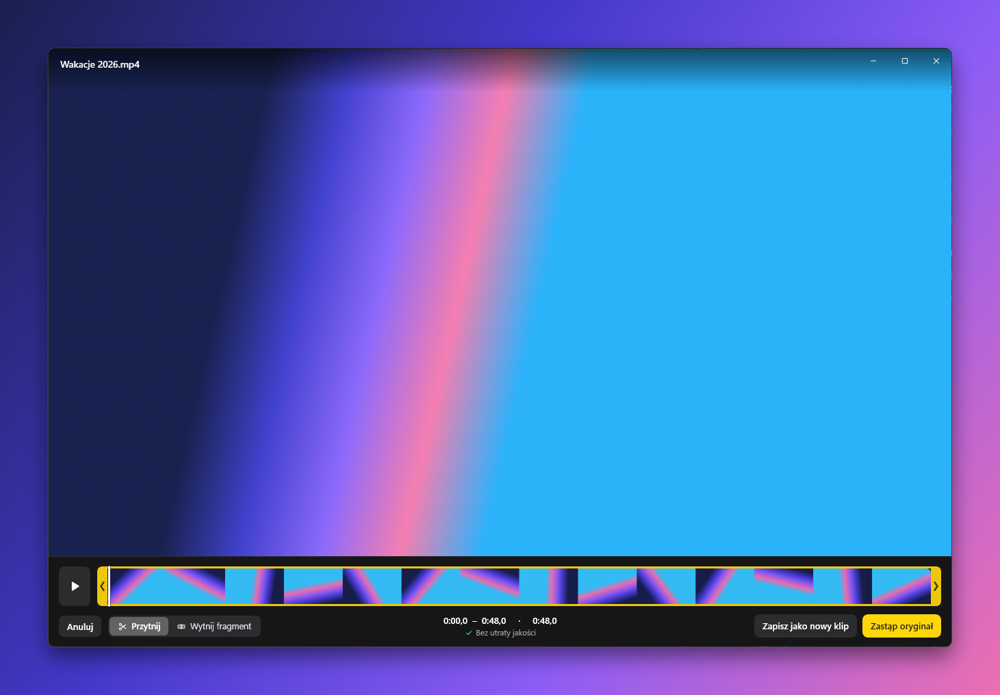
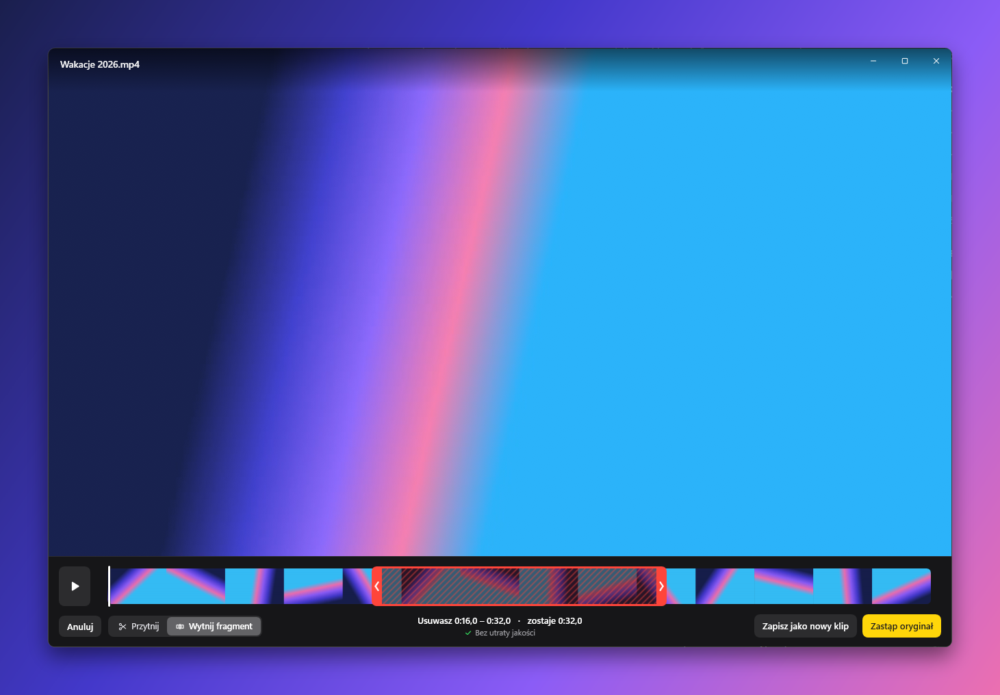
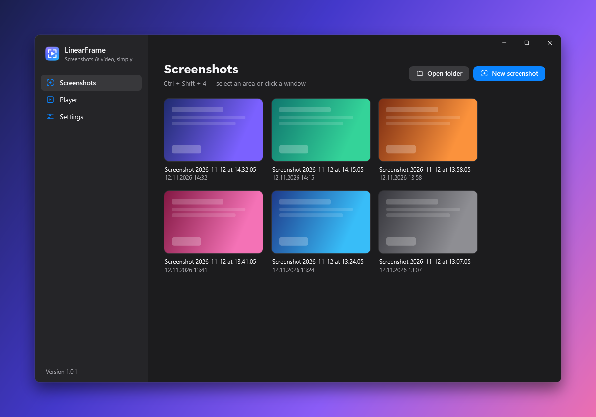
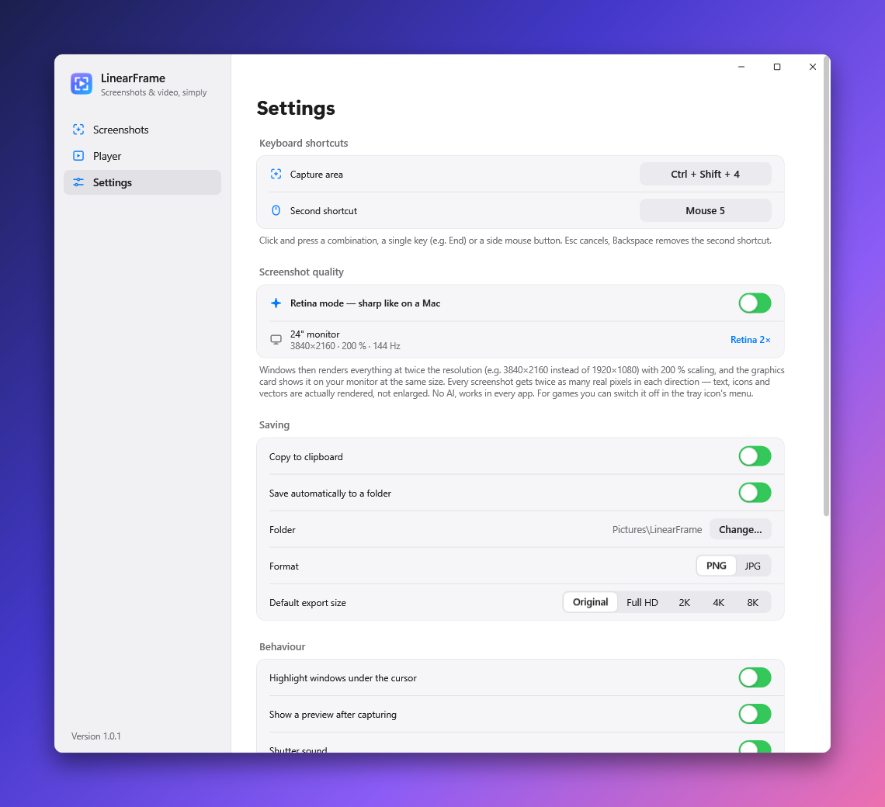
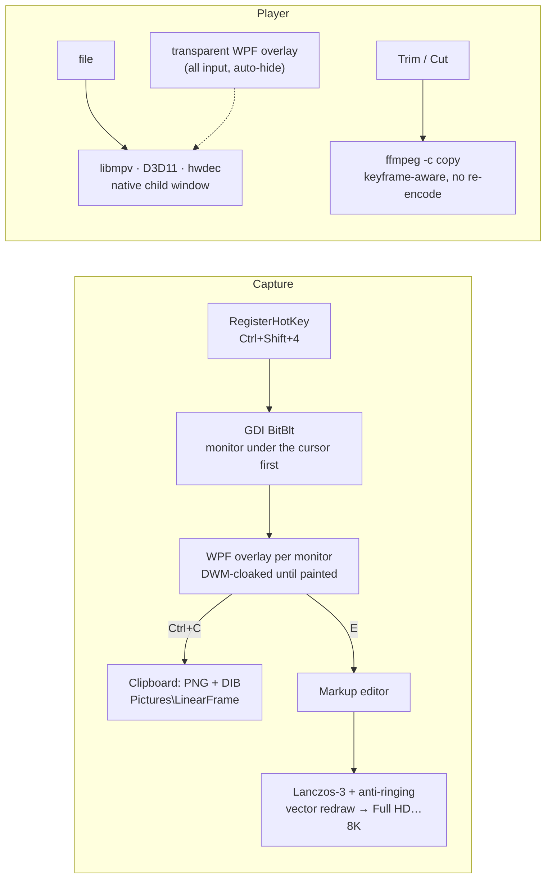

<p align="center">
  
</p>

<h1 align="center">LinearFrame</h1>

<p align="center">
  <b>Screenshots, a player for practically every format, and lossless trimming — for Windows.</b><br>
  Light, fast and quiet in the tray, with the polish and simplicity of macOS.
</p>

<p align="center">
  <a href="https://github.com/striktooo/LinearFrame/releases/latest"></a>
  
  <a href="LICENSE"></a>
</p>

<p align="center">
  <a href="README.pl.md">🇵🇱 Po polsku</a> ·
  <a href="#download">Download</a> ·
  <a href="#features">Features</a> ·
  <a href="#under-the-hood">Under the hood</a> ·
  <a href="#build-from-source">Build</a>
</p>


---

## Features

### 📸 Screenshots that feel like ⌘⇧4
Press **Ctrl + Shift + 4** and the screen freezes and dims. **Drag** to select any area — or just **click a window** to grab
exactly that window. Press **Ctrl + C** (or Enter): the shot goes to the clipboard *and* is saved as a PNG in `Pictures\LinearFrame`.
A floating thumbnail slides into the corner — click it to edit, drag it straight into a chat or an e-mail.

- Bind it to whatever suits you: a combination, **a single key** (End, F13, PrintScreen…) or **a side mouse button**
  (Mouse 4 / Mouse 5) — plus an optional second shortcut. Click the empty desktop to grab a whole monitor.
- Pick the output size right in the toolbar: **Original, Full HD, 2K, 4K or 8K**.
- Multi-monitor and per-monitor-DPI aware; captures real physical pixels. Arrow keys nudge the selection pixel by pixel.

### ✨ Retina mode — Mac-sharp screenshots on any monitor
A small button screenshots crisp on a Mac because macOS draws everything at **2×** (Retina). LinearFrame switches Windows into
exactly that with one click (*Settings → Screenshot quality*): the desktop renders at twice the resolution — e.g. 3840×2160 at
200 % scaling on a 1920×1080 monitor — and the graphics card scales it down to your panel, so everything keeps its size.
Every app now draws its text, icons and vector UI with four times as many real pixels, and every screenshot carries that detail.
**Real rendering — no upscaling, no AI.**

Needs NVIDIA DSR (4.00x, legacy scaling) or AMD Virtual Super Resolution; the app tells you where to switch it on. Your monitor
arrangement is kept, and a *"Keep?"* prompt reverts everything by itself after 15 seconds. Quick toggle in the tray menu
(e.g. off for games).

### ✏️ Markup — and frames that grow


Arrows, lines and underlines, highlighter, pen, rectangles, ellipses, text, numbered steps and a **blur/pixelate** tool for
anything private. Every mark stays editable (move, resize, recolour) with unlimited undo.

**Crop & extend** is the trick you won't find elsewhere: drag the frame *outwards* and LinearFrame detects the background colour
of the screenshot and fills the new space with it — seamlessly. One click gives you **16:9, 4:3, 1:1 or 9:16** with an even margin,
so two labels from a grey interface become a clean 4K slide:


### 🎬 A player for practically everything


MP4, MOV/HEVC from an iPhone, MKV, WebM, AVI, FLV, TS, AV1, VP9… and audio — MP3, FLAC, M4A, WAV, OGG, Opus. Hardware decoding,
QuickTime-style controls that disappear while you watch, a window that keeps the video's aspect ratio, speed control,
audio/subtitle tracks and "save this frame as a screenshot".

### ✂️ Trim and cut — without losing quality
| Trim: keep the selected part | Cut out: remove the selected part |
|---|---|
|  |  |

Click **Edit**, drag the yellow handles like on an iPhone, then **Save as new clip** or **Replace original** (the original goes to
the Recycle Bin). Switch to **Cut out** to remove a fragment from the middle — the rest is joined automatically.
Nothing is re-encoded: streams are copied bit for bit, so a 4 GB video is done in seconds and looks exactly like the source.

### 📚 Library, settings and quiet automatic updates
| | |
|---|---|
|  |  |

LinearFrame lives in the tray at **0 % CPU**. New versions download in the background, are verified (SHA-256) and installed
**while you're not using the app** — no installer, no admin rights, no server: updates come straight from this repository's Releases.

---

## Download

1. Download **`LinearFrame-x.y.z-win-x64.zip`** from [**Releases**](https://github.com/striktooo/LinearFrame/releases/latest).
2. Unzip it anywhere and run **`LinearFrame.exe`**. Nothing to install, .NET is built in.
3. SmartScreen may say *"Windows protected your PC"* (the app isn't code-signed yet): **More info → Run anyway**.

It starts with Windows (switch it off in Settings). To open videos with it by default: *Player → Use LinearFrame for videos and music*;
video files also get **Trim with LinearFrame** in the classic context menu.

## Keyboard

| Where | Keys |
|---|---|
| Anywhere | **Ctrl+Shift+4** capture (or your own key / mouse button) |
| While selecting | **Ctrl+C / Enter** copy & save · **E** edit · **Ctrl+S** save as · **Esc** cancel · **arrows** nudge · right-click clears |
| Editor | **V P H A L R O T N B** tools · **C** crop & extend · **Ctrl+Z / Ctrl+Shift+Z** · **Ctrl+C** copy · **Ctrl+S** done |
| Player | **Space** pause · **← →** 5 s · **J L** 10 s · **, .** frame step · **↑ ↓** volume · **M** mute · **F** full screen · **E** edit · **X** trim/cut · **I O** set in/out |

Command line: `LinearFrame.exe video.mp4` · `--trim video.mp4` · `--cut video.mp4` · `--capture` · `--settings` · `--exit`

---

## Under the hood

LinearFrame is a single C# / .NET 10 WPF app with a hand-made macOS-style theme (light & dark), talking directly to Win32,
plus two battle-tested engines shipped next to the exe: **mpv** for playback and **FFmpeg** for lossless editing.



<details>
<summary><b>Capture pipeline</b></summary>

- `RegisterHotKey` on a hidden window — zero polling, zero CPU while waiting. Side mouse buttons need a `WH_MOUSE_LL` hook; it exists
  only while a mouse button is bound, runs on its own thread (the mouse never waits for the UI) and swallows just that click.
- The monitor under the cursor is captured first (GDI `BitBlt` of the DWM-composed desktop, ~30 ms for 1080p) and its overlay
  is shown immediately; the other monitors follow a moment later. Overlay windows are created **DWM-cloaked** and revealed only
  after their first frame is painted, so there's no flash. A hidden off-screen overlay is rendered once at start-up to warm up
  code, styles and the render pipeline — the very first capture is as fast as every later one.
- Click-a-window uses `EnumWindows` + `DWMWA_EXTENDED_FRAME_BOUNDS` (real bounds without the invisible resize border),
  skipping cloaked, click-through and fully transparent overlay windows.
- Everything is in physical pixels; WPF runs Per-Monitor-V2 DPI aware.
</details>

<details>
<summary><b>Retina mode</b></summary>

- Monitors, their native panel resolution and current scaling come from the CCD API (`QueryDisplayConfig`,
  `DisplayConfigGetDeviceInfo`); the 2× desktop mode is looked up in the driver's mode list (that's where DSR / VSR modes appear).
- Every new mode is validated with `CDS_TEST` first, then all monitors are staged with `CDS_NORESET` and switched in one go.
  Monitor positions are recomputed so that screens that touched still touch on the same side (the primary stays at 0,0);
  layouts that can't be kept are refused instead of guessed.
- Scaling is set per monitor through `DisplayConfigSetDeviceInfo` — the same call the Windows Settings app uses —
  so 100 % becomes 200 %, 125 % becomes 250 %… and nothing changes size on screen.
- The previous modes are saved; switching off (or not confirming within 15 s) restores them exactly.
</details>

<details>
<summary><b>Editor & export</b></summary>

- Non-destructive document: original pixels + a *frame* rectangle (crop or extend, may reach beyond the image) + vector annotations.
- **Background detection**: the dominant colour of a two-pixel ring around the image (5-bit quantised histogram) fills extended areas.
- **Export**: the visible part of the screenshot is resampled with a separable, multi-threaded **Lanczos-3** filter with
  **anti-ringing** (no halos around UI edges), then every annotation is re-drawn as vectors at the target resolution — arrows
  and text stay razor sharp even at 8K. 16:9 frames land exactly on 1920×1080 / 2560×1440 / 3840×2160 / 7680×4320.
- Clipboard gets both a PNG stream (keeps transparency, used by browsers, Discord, Slack, Office) and a classic DIB.
</details>

<details>
<summary><b>Player</b></summary>

- **libmpv** renders into a native child window with its own D3D11 swap chain and hardware decoding (`hwdec=auto-safe`,
  e.g. d3d11va) — the smoothest path on Windows.
- Controls live in a separate transparent WPF window that sits exactly over the video and receives all input
  (resize edges included). While you watch, mpv stops notifying the UI about the playback position, so the UI thread sleeps.
- mpv events are read on a background thread and coalesced into at most ~8 UI updates per second.
</details>

<details>
<summary><b>Lossless trim & cut</b></summary>

- **Trim** = `ffmpeg -ss <start> -i in -t <len> -c copy`. MP4/MOV keep a frame-accurate start thanks to an edit list;
  other containers start on the previous keyframe.
- **Cut out** needs a clean join: the keyframe list is read from the container without decoding (`-c copy -f framecrc`),
  the end of the cut snaps to the next keyframe, both halves are stream-copied into temporary files (each with clean
  timestamps, B-frame tails included) and joined with the concat demuxer. Every result is verified by decoding in the self-test.
- *Replace original* stops playback, moves the original to the Recycle Bin and restores the file's dates.
</details>

<details>
<summary><b>Automatic updates (no server needed)</b></summary>

1. Twice a day: `GET api.github.com/repos/striktooo/LinearFrame/releases/latest` (just the version number — no telemetry).
2. A newer release → download `LinearFrame-x.y.z-win-x64.zip` from GitHub, verify it against the published `.sha256`.
3. While nothing is on screen, the files are swapped in place: Windows lets a running exe/DLL be *renamed*, so the old ones
   become `*.old`, the new ones are copied in, and the app restarts itself (rolling back if anything fails).
4. The new instance cleans up. A version guard prevents update loops. It can be switched off in Settings.
</details>

<details>
<summary><b>Measured performance</b> (Ryzen 7 5800X, RTX 4070, Windows 11, three 1080p monitors)</summary>

| Scenario | Result |
|---|---|
| Idle in the tray | **0 % CPU**, ~7 MB working set |
| Ctrl+Shift+4 → overlay on screen | **~75–130 ms** (monitor under the cursor), ~250 ms for all three |
| 1080p30 H.264 playback, controls hidden | **~0.6 % of total CPU** (≈10 % of one core, hardware decoding) |
| Lossless cut-out of a 10 s clip | ~2–3 s, clean decode |
| 520×300 screenshot → 8K export | ~2.4 s resample + ~2 s PNG |
</details>

<details>
<summary><b>Privacy</b></summary>

No accounts, no telemetry, no analytics. The only network traffic is the update check against this repository's GitHub
Releases (and the download of an update), which you can switch off. Screenshots never leave your PC unless you share them.
</details>

---

## Build from source

Requirements: Windows 10/11 and the [.NET 10 SDK](https://dotnet.microsoft.com/download).

```powershell
git clone https://github.com/striktooo/LinearFrame
cd LinearFrame
pwsh scripts/fetch-deps.ps1            # downloads libmpv + ffmpeg into ./deps
dotnet run --project src/LinearFrame   # run it
pwsh ./build.ps1                       # dist/LinearFrame-<version>-win-x64.zip
```

Self-test (no UI, ~1 min — capture, resampling, markup, crop & extend, trim/cut of MP4/MKV/MP3 with decode checks, libmpv):

```powershell
src\LinearFrame\bin\Debug\net10.0-windows\LinearFrame.exe --selftest $env:TEMP\lf-test
```

Releases are built by GitHub Actions: push a tag `vX.Y.Z` → the workflow builds the ZIP and publishes it; installed copies
update themselves within half a day.

```
src/LinearFrame/
  Core/      settings, tray, hotkeys, IPC, theme, localisation (PL/EN), updater
  Capture/   screen capture, window detection, selection overlay, floating thumbnail
  Editor/    markup document, tools, crop & extend, exporter (Full HD … 8K)
  Imaging/   pixel buffers, Lanczos resize, background detection, PNG/JPG, clipboard
  Player/    libmpv interop, player window + overlay, trim/cut bar, ffmpeg helpers
  UI/        main window (library / player / settings), icons, controls
  Dev/       self-test and the generator of these README images
```

## Ideas for later

AI upscaling (Real-ESRGAN via DirectML) · scrolling screenshots · screen recording to MP4/GIF · OCR (copy text from a screenshot) ·
pinning a screenshot on top of everything · code signing.

## License

LinearFrame's code is **MIT** — see [LICENSE](LICENSE). The downloadable package also contains mpv and FFmpeg (GPL);
see [THIRD-PARTY-NOTICES.md](THIRD-PARTY-NOTICES.md). Made with care in Poland 🇵🇱.
