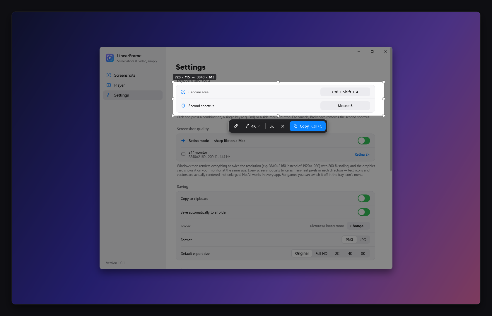
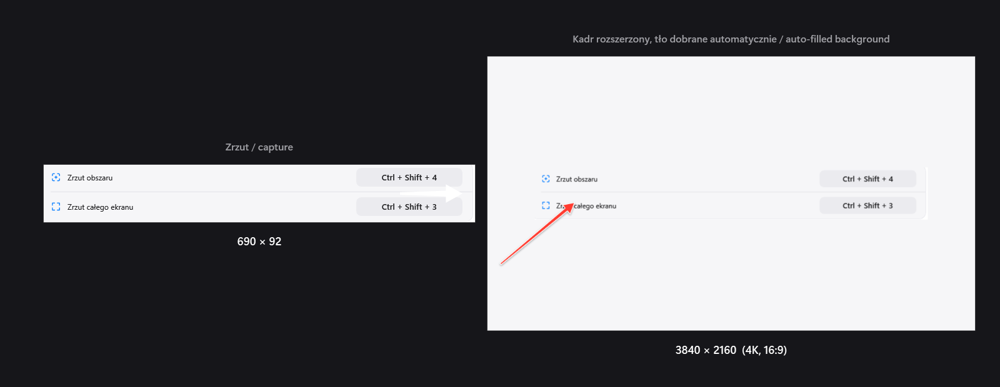
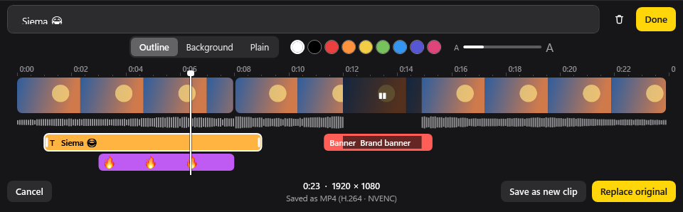
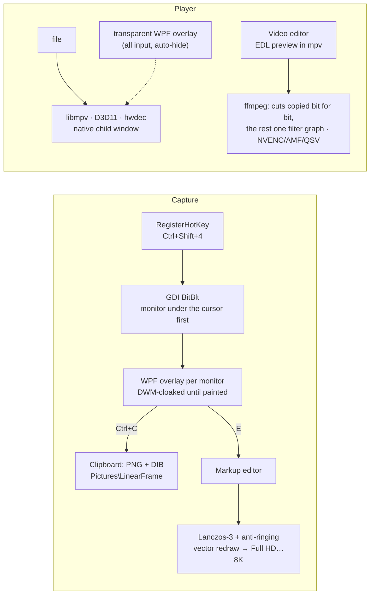

<p align="center">
  
</p>

<h1 align="center">LinearFrame</h1>

<p align="center">
  <b>Screenshots, a player for practically every format, and a quick video editor — for Windows.</b><br>
  Light, fast and quiet in the tray, with the polish and simplicity of macOS.
</p>

<p align="center">
  <a href="https://github.com/striktooo/LinearFrame/releases/latest"></a>
  
  <a href="LICENSE"></a>
</p>

<p align="center">
  <a href="README.pl.md">🇵🇱 Po polsku</a> ·
  <a href="#download">Download</a> ·
  <a href="#features">Features</a> ·
  <a href="#under-the-hood">Under the hood</a> ·
  <a href="#build-from-source">Build</a>
</p>



---

## Features

### 📸 Screenshots that feel like ⌘⇧4
Press **Ctrl + Shift + 4** and the screen freezes and dims. **Drag** to select any area — or just **click a window** to grab
exactly that window. Press **Ctrl + C** (or Enter): the shot goes to the clipboard *and* is saved as a PNG in `Pictures\LinearFrame`.
A floating thumbnail slides into the corner — click it to edit, drag it straight into a chat or an e-mail.

- Bind it to whatever suits you: a combination, **a single key** (End, F13, PrintScreen…) or **a side mouse button**
  (Mouse 4 / Mouse 5) — plus an optional second shortcut. Click the empty desktop to grab a whole monitor.
- Pick the output size right in the toolbar: **Original, Full HD, 2K, 4K or 8K**.
- **Ctrl + C + C** (C twice, Ctrl held) *adds* the shot to the ones already in the clipboard — up to 10 — and one Ctrl+V pastes
  them all into a chat, a mail or a folder. A normal Ctrl+C replaces the clipboard as always; **Ctrl+Shift+Backspace** (or your
  own shortcut) empties it.
- **T** (or the text button) copies the **text** in the selection instead of the picture — offline, Polish letters included.
  A **QR code** in the selection gets a button that opens its link (also on the thumbnail afterwards).
- Multi-monitor and per-monitor-DPI aware; captures real physical pixels. Arrow keys nudge the selection pixel by pixel.

### ✨ HD captures — really rendered at up to 4×, never upscaled
A screenshot normally holds exactly the pixels that are on your screen — zoom in on a small button and you see squares.
With **HD captures** on, LinearFrame re-renders what you selected instead: the window under the selection is moved for a
split second onto an invisible *virtual screen* that runs at 200–400 % scaling. Windows then tells the app to draw itself
for that scaling — exactly what happens when you drag a window onto a 4K or 8K monitor — LinearFrame captures that picture
and puts the window back. The frozen overlay hides all of it; your real monitor, its resolution and its scaling are never touched.

- Text, icons and vector UI come out with **2×, 3× or 4× the pixels per side**, drawn by the app itself. No AI, no upscaling.
- Honest by design: LinearFrame checks that the new picture shows the same content *and* really carries more detail. Where an
  app can't do that (the desktop and taskbar, old apps without high-DPI support, video frames) you get the normal screenshot,
  and the preview says why.
- One-time set-up in *Settings → HD captures*: a small open-source driver for the virtual screen
  ([Virtual Display Driver](https://github.com/VirtualDrivers/Virtual-Display-Driver), MIT) is downloaded, verified and
  installed — Windows asks you to confirm. The virtual screen is only attached while a capture is being rendered.

### ✏️ Markup — and frames that grow


Arrows, highlighter, pen, text, numbered steps and a **blur/pixelate** tool for
anything private. Every mark stays editable (move, resize, recolour) with unlimited undo. **Text** is the video editor's caption
tool itself: TikTok Sans with an outline, a plate or plain, TikTok's colours and the iPhone emoji gallery; drag a corner to
resize — the lines stay as you typed them.

**Crop & extend** is the trick you won't find elsewhere: drag the frame *outwards* and LinearFrame detects the background colour
of the screenshot and fills the new space with it — seamlessly. One click gives you **16:9, 4:3, 1:1 or 9:16** with an even margin,
so two labels from a grey interface become a clean 4K slide:



### 🎬 A player for practically everything


MP4, MOV/HEVC from an iPhone, MKV, WebM, AVI, FLV, TS, AV1, VP9… and audio — MP3, FLAC, M4A, WAV, OGG, Opus. Hardware decoding,
QuickTime-style controls that disappear while you watch, a window that keeps the video's aspect ratio, audio/subtitle tracks,
and **copy or save the frame on screen**. Music shows its cover and the **whole song as a waveform** the moment it opens — click or
drag on it to jump around; cover, title and waveform grow with the window.

### 🖼️ Pictures, too
Open a JPG, PNG, HEIC, WebP… with LinearFrame and it lands in a clean viewer: fitted to the window (never stretched past 100 %),
the wheel zooms where the cursor is, drag to look around, double-click for actual pixels. Phone photos stand the right way up,
a screen-sized copy appears instantly and every pixel is decoded only when you zoom in. **← →** walk through the folder,
**Edit** opens the markup editor.

**Live Text**, like on an iPhone: the text in a picture is recognised in the background — the cursor turns into a text cursor over
it, drag to select words (a double-click takes the line), **Ctrl+C** copies them, the text button copies everything. A QR code in
the picture gets a button that opens its link. Neat handwriting is read too; scribbles may not be.

Text recognition is two engines working together, fully offline: screens are read by Windows' own OCR (fast, and it knows Polish
letters); **photos** — a parcel label, a page shot at an angle, text on a busy background, a number printed up the side of a
barcode — go to **PaddleOCR PP-OCRv5**, which finds every line at any angle, straightens it and reads it together with Windows'
engine; line by line the better reading wins, and Polish letters the photo model drops are put back from Windows' own spelling
dictionary.

### ✂️ Video editor — cuts, captions, emoji, a banner, any format


Click ✂️ in the controls (or press **E**) and the editor opens under the video, with the film strip and the waveform:

- **Split** at the playhead and **Delete** pieces — cut out as many fragments as you like. **Join** adds another video after this one.
- **Text** — captions in TikTok's own font (TikTok Sans): white with a black outline by default, a background plate, or plain;
  TikTok's colours, any size; drag them anywhere on the video (they snap to the middle), double-click to retype.
- **Emoji** — the smiley next to the caption opens the real iPhone emoji gallery (Apple's artwork, downloaded once): recently
  used first and a search in Polish and English ("serce", "ogień", "fire"…). A caption of just an emoji is a sticker.
- **Banner** — puts your brand banner (a video with transparency, e.g. a ProRes 4444 .mov) at the playhead: the video keeps
  playing for 0.7 s, freezes while the banner plays and moves again 0.4 s before the banner ends. Move it on the video or on the
  timeline, resize it, **Top / Middle / Bottom**. Right-click the button to pick another banner file.
- **Format** — 9:16, 1:1, 4:5, 16:9 or the original; fit or fill, zoom and drag the video inside the frame, blurred or black
  background, resolution.

The preview plays live in the player (the GPU frames the video, the banner runs in a layer of its own), with undo/redo for
everything. **Save as new clip** or **Replace original** (the original goes to the Recycle Bin): cuts of one file are copied
bit for bit — no quality loss, seconds even for 4 GB; everything else is rendered once to MP4 (H.264), on the graphics card when
there is one (NVIDIA, AMD, Intel), frame-exact, with the banner's sound mixed in.

### 📚 Library, settings and quiet automatic updates
| | |
|---|---|
|  |  |

LinearFrame lives in the tray at **0 % CPU**. New versions download in the background, are verified (SHA-256) and installed
**while you're not using the app** — no installer, no admin rights, no server: updates come straight from this repository's Releases.
An update only downloads the app itself (about 55 MB); the engines are fetched again only when they actually changed.

---

## Download

1. Download **`LinearFrame-x.y.z-win-x64.zip`** from [**Releases**](https://github.com/striktooo/LinearFrame/releases/latest).
2. Unzip it anywhere and run **`LinearFrame.exe`**. Nothing to install, .NET is built in.
3. SmartScreen may say *"Windows protected your PC"* (the app isn't code-signed yet): **More info → Run anyway**.

It starts the moment you sign in to Windows — through a small task of your own in Task Scheduler, no admin rights (programs in
the classic "Run" list are held back by Windows for 20–30 s); switch it off in Settings. To open videos, music or pictures with it by default: *Player → Use LinearFrame for videos, music and pictures*;
every format then gets its own flat icon — a blue film, a pink note, a green picture with the format on a label — so a folder
shows at a glance what is what; video files also get **Edit with LinearFrame** in the classic context menu.

## Keyboard

| Where | Keys |
|---|---|
| Anywhere | **Ctrl+Shift+4** capture (or your own key / mouse button) · **Ctrl+Shift+Backspace** empty the clipboard |
| While selecting | **Ctrl+C / Enter** copy & save · **Ctrl+C+C** add to the clipboard · **T** copy the text · **E** edit · **Ctrl+S** save as · **Esc** cancel · **arrows** nudge · right-click clears |
| Editor | **V P H A T N B** tools · **C** crop & extend · **Ctrl+Z / Ctrl+Shift+Z** · **Ctrl+C** copy · **Ctrl+S** done |
| Player | **Space** pause · **← →** 5 s · **J L** 10 s · **, .** frame step · **↑ ↓** volume · **M** mute · **F** full screen · **Ctrl+C** copy frame · **E** video editor |
| Video editor | **Space** play · **← →** one frame (**Shift** 1 s) · **S** split · **Delete** delete · **T** text · **Ctrl+Z / Ctrl+Y** · **Esc** done / leave |
| Pictures | **← →** previous / next · **wheel** zoom · **double-click**, **0 / 1** whole picture / actual pixels · **Ctrl+C** copy (the selected text first) · **Ctrl+A** select all text · **E** edit · **Esc** close |

Command line: `LinearFrame.exe video.mp4` · `--trim video.mp4` · `--cut video.mp4` · `--capture` · `--settings` · `--exit`

---

## Under the hood

LinearFrame is a single C# / .NET 10 WPF app with a hand-made macOS-style theme (light & dark), talking directly to Win32,
plus battle-tested engines shipped next to the exe: **mpv** for playback, **FFmpeg** for editing and **ONNX Runtime** with
PaddleOCR's PP-OCRv5 models for reading text in photos.



<details>
<summary><b>Capture pipeline</b></summary>

- `RegisterHotKey` on a hidden window — zero polling, zero CPU while waiting. Side mouse buttons need a `WH_MOUSE_LL` hook; it exists
  only while a mouse button is bound, runs on its own thread (the mouse never waits for the UI) and swallows just that click.
- The monitor under the cursor is captured first (GDI `BitBlt` of the DWM-composed desktop, ~30 ms for 1080p) and its overlay
  is shown immediately; the other monitors follow a moment later. Overlay windows are created **DWM-cloaked** and revealed only
  after their first frame is painted, so there's no flash. After start-up a tiny cloaked, click-through overlay is drawn in a
  corner of every monitor, so WPF has its Direct3D device for each screen ready before you press the shortcut. Right after
  Windows starts that set-up alone can take several seconds, so the warm-up is repeated a few times in the first minutes after
  boot and after waking from sleep — the very first capture is as fast as every later one.
- Click-a-window uses `EnumWindows` + `DWMWA_EXTENDED_FRAME_BOUNDS` (real bounds without the invisible resize border),
  skipping cloaked, click-through and fully transparent overlay windows.
- Everything is in physical pixels; WPF runs Per-Monitor-V2 DPI aware.
</details>

<details>
<summary><b>HD captures</b></summary>

- The canvas is an indirect-display (IddCx) virtual monitor from the open-source Virtual Display Driver. While idle it is
  detached from the desktop (`ChangeDisplaySettingsEx` with a zero size); for a capture it is attached at 3840×2160 … 7680×4320
  with 200–400 % scaling (`DisplayConfigSetDeviceInfo`, the call the Settings app itself uses). No admin rights after set-up.
- The window that owns the selection comes from the z-order snapshot taken when the screen was frozen. It is moved with
  `SetWindowPos(SWP_ASYNCWINDOWPOS)`; Windows sends it `WM_DPICHANGED`, the app lays itself out at the same logical size with
  N× the pixels, and afterwards it is put back into the exact rectangle it came from.
- The virtual screen is read with `BitBlt` until the picture is stable, then verified against the frozen 1× capture:
  registration (best offset within ±14 px on blurred greyscale), structural similarity (zero-mean normalised correlation)
  and a *detail gain* test — a real N× render has about N times the edge energy of the same picture merely stretched
  (measured: 3.8 for a real 4× render, 0.75 for a stretched one). Stretched or changed content is rejected and the normal
  capture is used, so the result is never a blurry enlargement.
- Big selections are rendered at a lower factor (a whole window at 4× would be a 30-megapixel picture).
- Set-up: the driver ZIP comes from its GitHub release, is checked against a pinned SHA-256 and installed by an elevated
  copy of the app through SetupAPI (what `devcon install` does).
</details>

<details>
<summary><b>Editor & export</b></summary>

- Non-destructive document: original pixels + a *frame* rectangle (crop or extend, may reach beyond the image) + vector annotations.
- **Background detection**: the dominant colour of a two-pixel ring around the image (5-bit quantised histogram) fills extended areas.
- **Export**: the visible part of the screenshot is resampled with a separable, multi-threaded **Lanczos-3** filter with
  **anti-ringing** (no halos around UI edges), then every annotation is re-drawn as vectors at the target resolution — arrows
  and text stay razor sharp even at 8K. 16:9 frames land exactly on 1920×1080 / 2560×1440 / 3840×2160 / 7680×4320.
- Clipboard gets both a PNG stream (keeps transparency, used by browsers, Discord, Slack, Office) and a classic DIB.
</details>

<details>
<summary><b>Player</b></summary>

- **libmpv** renders into a native child window with its own D3D11 swap chain and hardware decoding (`hwdec=auto-safe`,
  e.g. d3d11va) — the smoothest path on Windows.
- Controls live in a separate transparent WPF window that sits exactly over the video and receives all input
  (resize edges included). While you watch, mpv stops notifying the UI about the playback position, so the UI thread sleeps.
- mpv events are read on a background thread and coalesced into at most ~8 UI updates per second.
</details>

<details>
<summary><b>Video editor</b></summary>

- Three time lines: the clips joined end to end (captions and banners are anchored here, so they stay with "their" moment when
  something before them is cut), the kept pieces (what mpv plays as one EDL timeline) and the finished video (plus the banner
  freezes). A freeze is mpv pausing itself on the exact frame (checked on mpv's event thread) while a clock runs.
- Format preview: mpv renders only into the part of the frame the video covers and `video-zoom`/`video-pan` put the picture where
  it is - the GPU does it, playback stays as smooth as without a format. The blurred background is a WPF layer behind it.
- The banner preview is a click-through layered window fed with premultiplied frames that FFmpeg decodes on the fly, at exactly
  the size shown, into a short queue (a handful of frames, however big the window).
- **Copy** (only cuts of one file): one piece = `ffmpeg -ss -t -c copy` (MP4/MOV keep a frame-accurate start thanks to an edit
  list); several pieces = the concat demuxer reading the file's in/out points (every later piece starts on a keyframe, found
  without decoding via `-c copy -f framecrc`). With B-frames such joins aren't frame-exact, so those are rendered instead.
- **Render**: one FFmpeg filter graph - every clip decoded once, frame-exact trims, each freeze read through its own input and
  held with `tpad`, every piece framed onto the canvas (scale/crop/pad or a blurred copy), the banner cropped to the box where it
  really is on its canvas (found once with `alphaextract,bbox`), captions and emoji as pictures from the same drawing code as the
  preview, sound concatenated with silence in freezes and the banner's sound mixed in. Encoder: NVENC → AMF → QSV → x264.
- *Replace original* stops playback, moves the original to the Recycle Bin and restores the file's dates.
</details>

<details>
<summary><b>Automatic updates (no server needed)</b></summary>

1. Twice a day: `GET api.github.com/repos/striktooo/LinearFrame/releases/latest` (just the version number — no telemetry).
2. A newer release → download `LinearFrame-x.y.z-win-x64.zip` from GitHub, verify it against the published `.sha256`.
3. While nothing is on screen, the files are swapped in place: Windows lets a running exe/DLL be *renamed*, so the old ones
   become `*.old`, the new ones are copied in, and the app restarts itself (rolling back if anything fails).
4. The new instance cleans up. A version guard prevents update loops. It can be switched off in Settings.
</details>

<details>
<summary><b>Measured performance</b> (Ryzen 7 5800X, RTX 4070, Windows 11, three 1080p monitors)</summary>

| Scenario | Result |
|---|---|
| Idle in the tray | **0 % CPU**, ~7 MB working set |
| Ctrl+Shift+4 → overlay on screen | **~75–130 ms** (monitor under the cursor), ~250 ms for all three |
| 1080p30 H.264 playback, controls hidden | **~0.6 % of total CPU** (≈10 % of one core, hardware decoding) |
| Lossless cut-out of a 10 s clip | ~2–3 s, clean decode |
| 520×300 screenshot → 8K export | ~2.4 s resample + ~2 s PNG |
</details>

<details>
<summary><b>Privacy</b></summary>

No accounts, no telemetry, no analytics. The only network traffic is the update check against this repository's GitHub
Releases (and the download of an update), which you can switch off. Screenshots never leave your PC unless you share them.
</details>

---

## Build from source

Requirements: Windows 10/11 and the [.NET 10 SDK](https://dotnet.microsoft.com/download).

```powershell
git clone https://github.com/striktooo/LinearFrame
cd LinearFrame
pwsh scripts/fetch-deps.ps1            # downloads libmpv + ffmpeg into ./deps
dotnet run --project src/LinearFrame   # run it
pwsh ./build.ps1                       # dist/LinearFrame-<version>-win-x64.zip
```

Self-test (~1 min — capture, resampling, markup, crop & extend, trim/cut of MP4/MKV/MP3 with decode checks, libmpv, the video
editor's time lines, lossless joins and a full render with a banner freeze; it opens a few windows and injects test key presses):

```powershell
src\LinearFrame\bin\Debug\net10.0-windows\LinearFrame.exe --selftest $env:TEMP\lf-test
```

Releases are built by GitHub Actions: push a tag `vX.Y.Z` → the workflow builds the ZIP and publishes it; installed copies
update themselves within half a day.

```
src/LinearFrame/
  Core/      settings, tray, hotkeys, IPC, theme, localisation (PL/EN), updater
  Capture/   screen capture, window detection, selection overlay, floating thumbnail
  Editor/    markup document, tools, crop & extend, exporter (Full HD … 8K)
  Imaging/   pixel buffers, Lanczos resize, background detection, PNG/JPG, clipboard
  Player/    libmpv interop, player window + overlay, ffmpeg helpers
    Edit/    video editor: edit model, timeline, captions, Apple emoji, banner preview, export
  UI/        main window (library / player / settings), icons, controls
  Dev/       self-test and the generator of these README images
```

## Ideas for later

AI upscaling (Real-ESRGAN via DirectML) · scrolling screenshots · screen recording to MP4/GIF ·
pinning a screenshot on top of everything · code signing.

## License

LinearFrame's code is **MIT** — see [LICENSE](LICENSE). The downloadable package also contains mpv and FFmpeg (GPL);
see [THIRD-PARTY-NOTICES.md](THIRD-PARTY-NOTICES.md). Made with care in Poland 🇵🇱.
