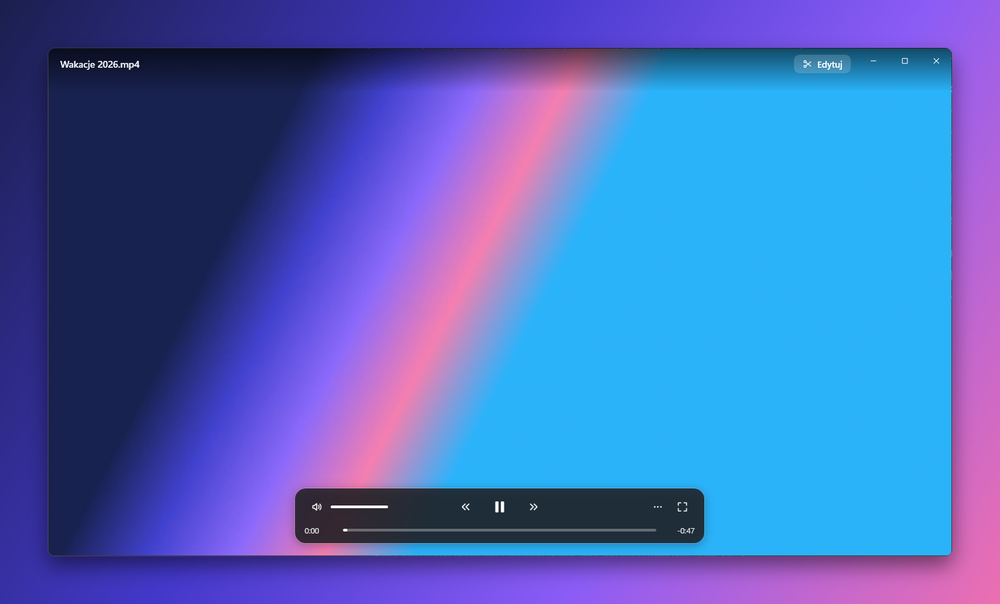
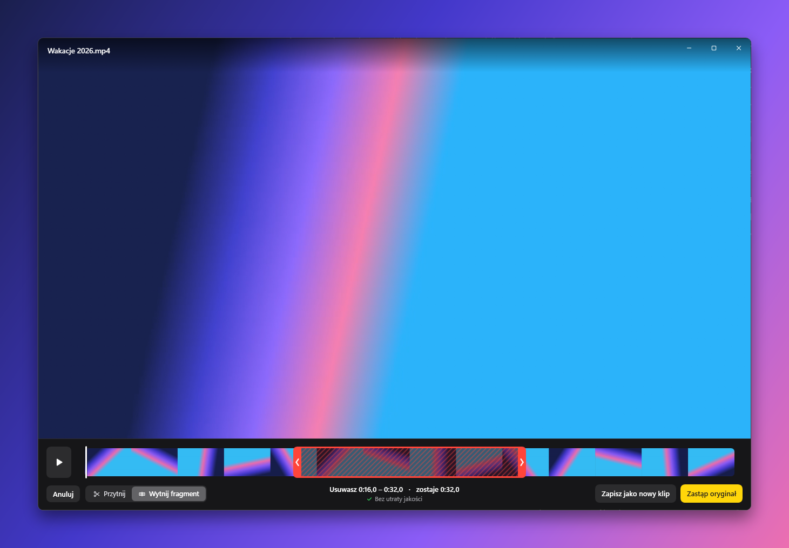
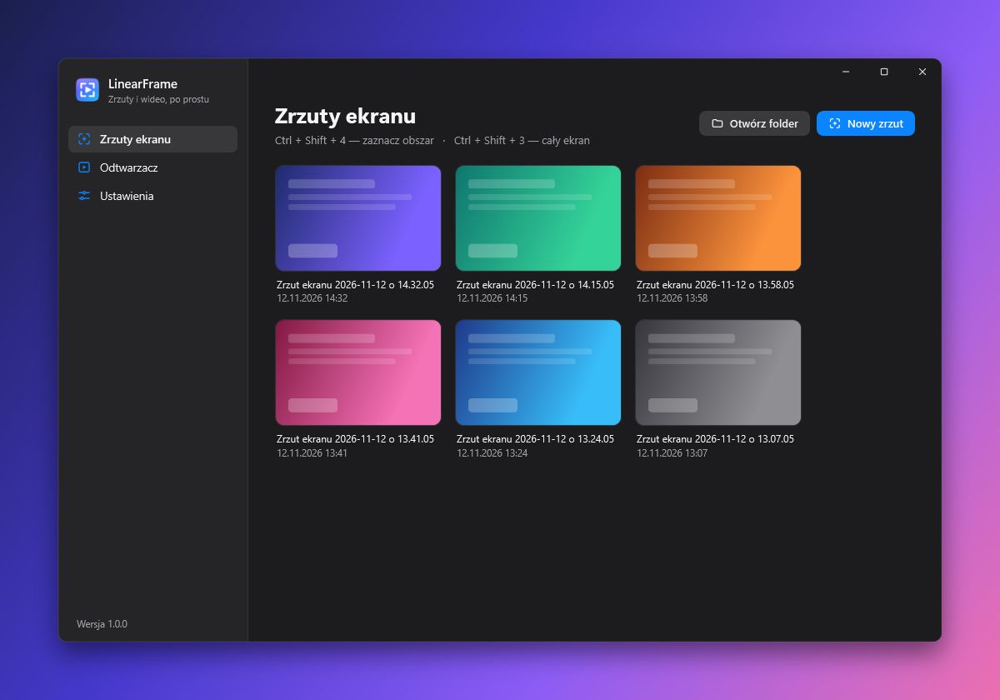
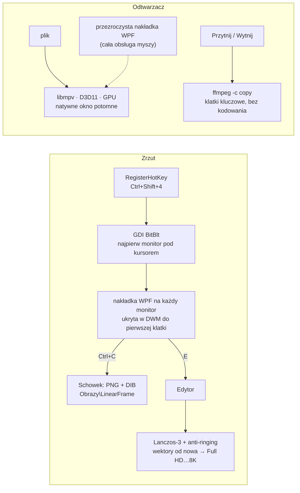

<p align="center">
  
</p>

<h1 align="center">LinearFrame</h1>

<p align="center">
  <b>Zrzuty ekranu, odtwarzacz praktycznie każdego formatu i przycinanie bez utraty jakości — dla Windows.</b><br>
  Lekki, szybki, cichy w zasobniku. Prosty i dopracowany jak macOS.
</p>

<p align="center">
  <a href="https://github.com/striktooo/LinearFrame/releases/latest"></a>
  
  <a href="LICENSE"></a>
</p>

<p align="center">
  <a href="README.md">🇬🇧 English</a> ·
  <a href="#pobieranie">Pobieranie</a> ·
  <a href="#co-potrafi">Co potrafi</a> ·
  <a href="#jak-to-działa-od-środka">Technikalia</a>
</p>


---

## Co potrafi

### 📸 Zrzuty jak ⌘⇧4 na Macu
Naciskasz **Ctrl + Shift + 4**: ekran zamarza i lekko przyciemnia się. **Przeciągasz** myszką po tym, co chcesz, albo po prostu
**klikasz okno**, żeby złapać dokładnie to okno. **Ctrl + C** (albo Enter) — zrzut jest w schowku *i* zapisany jako PNG w
`Obrazy\LinearFrame`. W rogu wysuwa się miniaturka: kliknięcie otwiera edytor, a przeciągnięcie wrzuca plik prosto do czatu czy maila.

- **Ctrl + Shift + 3** — cały ekran. Oba skróty zmienisz w Ustawieniach.
- Rozmiar wybierasz od razu na pasku: **Oryginał, Full HD, 2K, 4K albo 8K**.
- Wiele monitorów i różne skalowania (DPI); prawdziwe, fizyczne piksele. Strzałkami przesuwasz zaznaczenie co piksel.

### ✏️ Adnotacje i kadr, który rośnie


Strzałki, linie i podkreślenia, zakreślacz, pióro, prostokąty, elipsy, tekst, numerowane kroki i **zamazywanie** prywatnych rzeczy.
Każdy element da się potem przesunąć, powiększyć i przemalować; cofanie bez limitu.

**Kadruj i rozszerz** to coś, czego nie ma gdzie indziej: ciągniesz ramkę *na zewnątrz*, a LinearFrame rozpoznaje kolor tła
zrzutu i dopełnia nim nowe miejsce — bez szwów. Jedno kliknięcie i masz **16:9, 4:3, 1:1 albo 9:16** z równym marginesem, więc
dwa napisy z szarego interfejsu zamieniają się w czysty slajd 4K:


### 🎬 Odtwarzacz praktycznie wszystkiego


MP4, MOV/HEVC z iPhone'a, MKV, WebM, AVI, FLV, TS, AV1, VP9… i muzyka — MP3, FLAC, M4A, WAV, OGG, Opus. Dekodowanie na karcie
graficznej, kontrolki w stylu QuickTime znikające w trakcie oglądania, okno trzymające proporcje filmu, prędkość, ścieżki audio
i napisy, „zapisz tę klatkę jako zrzut”.

### ✂️ Przycinanie i wycinanie — bez utraty jakości
| Przytnij: zostaw zaznaczony fragment | Wytnij fragment: usuń zaznaczenie |
|---|---|
|  |  |

Klikasz **Edytuj**, przeciągasz żółte uchwyty jak w iPhonie i wybierasz **Zapisz jako nowy klip** albo **Zastąp oryginał**
(oryginał trafia do Kosza). Tryb **Wytnij fragment** usuwa kawałek ze środka i sam skleja resztę. Nic nie jest kodowane od nowa —
strumienie są kopiowane bit w bit, więc nawet film 4 GB jest gotowy w kilka sekund i wygląda dokładnie jak źródło.

### 📚 Biblioteka, ustawienia i ciche aktualizacje
| | |
|---|---|
|  |  |

LinearFrame siedzi w zasobniku i zużywa **0 % CPU**. Nowe wersje pobierają się w tle, są sprawdzane (SHA-256) i instalują się
**wtedy, gdy nie korzystasz z aplikacji** — bez instalatora, bez uprawnień administratora i bez żadnego serwera: aktualizacje
przychodzą prosto z zakładki Releases tego repozytorium.

---

## Pobieranie

1. Pobierz **`LinearFrame-x.y.z-win-x64.zip`** z [**Releases**](https://github.com/striktooo/LinearFrame/releases/latest).
2. Rozpakuj gdziekolwiek i uruchom **`LinearFrame.exe`**. Nic nie instalujesz, .NET jest w środku.
3. Jeśli pojawi się „System Windows ochronił ten komputer” (aplikacja nie ma jeszcze certyfikatu podpisu):
   **Więcej informacji → Uruchom mimo to**.

Aplikacja startuje razem z Windows (wyłączysz w Ustawieniach). Żeby otwierała filmy domyślnie: *Odtwarzacz → Otwieraj wideo
i muzykę w LinearFrame*; pliki wideo dostają też pozycję **Przytnij w LinearFrame** w klasycznym menu kontekstowym.

## Skróty

| Gdzie | Klawisze |
|---|---|
| Wszędzie | **Ctrl+Shift+4** obszar · **Ctrl+Shift+3** cały ekran |
| Przy zaznaczaniu | **Ctrl+C / Enter** kopiuj i zapisz · **E** edytuj · **Ctrl+S** zapisz jako · **Esc** anuluj · **strzałki** przesuń · prawy klik czyści |
| Edytor | **V P H A L R O T N B** narzędzia · **C** kadruj i rozszerz · **Ctrl+Z / Ctrl+Shift+Z** · **Ctrl+C** kopiuj · **Ctrl+S** gotowe |
| Odtwarzacz | **Spacja** pauza · **← →** 5 s · **J L** 10 s · **, .** klatka · **↑ ↓** głośność · **M** wycisz · **F** pełny ekran · **E** edycja · **X** przytnij/wytnij · **I O** początek/koniec |

Wiersz poleceń: `LinearFrame.exe film.mp4` · `--trim film.mp4` · `--cut film.mp4` · `--capture` · `--capture-full` · `--settings` · `--exit`

---

## Jak to działa od środka

Jedna aplikacja C# / .NET 10 WPF z ręcznie zrobionym motywem w stylu macOS (jasny i ciemny), rozmawiająca bezpośrednio z Win32,
plus dwa sprawdzone silniki obok pliku exe: **mpv** do odtwarzania i **FFmpeg** do bezstratnej edycji.



<details>
<summary><b>Zrzuty</b></summary>

- Skróty przez `RegisterHotKey` na ukrytym oknie — zero odpytywania, zero CPU w oczekiwaniu.
- Najpierw zrzucany jest monitor pod kursorem (GDI `BitBlt` skomponowanego pulpitu, ok. 30 ms dla 1080p) i od razu pokazuje się
  jego nakładka; pozostałe monitory dochodzą chwilę później. Okna nakładki powstają jako „ukryte w DWM” (cloak) i odsłaniają się
  dopiero po namalowaniu pierwszej klatki — bez mignięcia. Po starcie aplikacja raz „rozgrzewa” niewidoczną nakładkę poza ekranem,
  więc już pierwszy zrzut jest tak szybki jak kolejne.
- Klikanie okien: `EnumWindows` + `DWMWA_EXTENDED_FRAME_BOUNDS` (prawdziwe granice bez niewidzialnej ramki), z pominięciem okien
  ukrytych, przezroczystych dla myszy i nakładek typu overlay.
- Wszystko w fizycznych pikselach; WPF działa w trybie Per-Monitor-V2 DPI.
</details>

<details>
<summary><b>Edytor i eksport</b></summary>

- Nieniszczący dokument: oryginalne piksele + prostokąt *kadru* (przycięcie albo rozszerzenie, może wychodzić poza obraz)
  + adnotacje wektorowe.
- **Wykrywanie tła**: dominujący kolor dwupikselowej obwódki obrazu (histogram 5-bitowy) wypełnia rozszerzony kadr.
- **Eksport**: widoczna część zrzutu jest skalowana separowalnym, wielowątkowym filtrem **Lanczos-3** z **anti-ringingiem**
  (bez obwódek przy krawędziach interfejsu), a każda adnotacja jest rysowana od nowa jako wektor w docelowej rozdzielczości —
  strzałki i tekst są ostre nawet w 8K. Kadr 16:9 trafia dokładnie w 1920×1080 / 2560×1440 / 3840×2160 / 7680×4320.
- Do schowka trafia strumień PNG (z przezroczystością — przeglądarki, Discord, Slack, Office) oraz klasyczna bitmapa DIB.
</details>

<details>
<summary><b>Odtwarzacz</b></summary>

- **libmpv** rysuje w natywnym oknie potomnym z własnym łańcuchem D3D11 i dekodowaniem sprzętowym (`hwdec=auto-safe`,
  np. d3d11va) — najpłynniejsza droga w Windows.
- Kontrolki są w osobnym, przezroczystym oknie WPF leżącym dokładnie nad filmem i przejmującym całą obsługę myszy (także krawędzie
  do zmiany rozmiaru). W trakcie oglądania mpv przestaje informować interfejs o pozycji, więc wątek UI śpi.
- Zdarzenia mpv są czytane w wątku w tle i łączone w najwyżej ~8 aktualizacji interfejsu na sekundę.
</details>

<details>
<summary><b>Bezstratne przycinanie i wycinanie</b></summary>

- **Przytnij** = `ffmpeg -ss <start> -i plik -t <długość> -c copy`. MP4/MOV zaczynają się co do klatki dzięki liście edycji (edit list),
  inne kontenery od poprzedniej klatki kluczowej.
- **Wytnij fragment** wymaga czystego sklejenia: lista klatek kluczowych jest czytana z kontenera bez dekodowania
  (`-c copy -f framecrc`), koniec wycięcia dociąga się do najbliższej klatki kluczowej, obie połówki są kopiowane do plików
  tymczasowych (każda z czystymi znacznikami czasu) i łączone demultiplekserem concat. Autotest dekoduje każdy wynik.
- *Zastąp oryginał* zatrzymuje odtwarzanie, przenosi oryginał do Kosza i przywraca daty pliku.
</details>

<details>
<summary><b>Automatyczne aktualizacje (bez serwera)</b></summary>

1. Dwa razy dziennie: `GET api.github.com/repos/striktooo/LinearFrame/releases/latest` (tylko numer wersji — zero telemetrii).
2. Nowsza wersja → pobranie `LinearFrame-x.y.z-win-x64.zip` z GitHuba i sprawdzenie z opublikowanym `.sha256`.
3. Gdy nic nie jest otwarte, pliki są podmieniane w miejscu: Windows pozwala *zmienić nazwę* działającego exe/DLL, więc stare stają
   się `*.old`, nowe są kopiowane, a aplikacja sama się restartuje (z wycofaniem zmian, jeśli coś pójdzie nie tak).
4. Nowa instancja sprząta. Zabezpieczenie wersji chroni przed zapętleniem. Można to wyłączyć w Ustawieniach.
</details>

<details>
<summary><b>Zmierzona wydajność</b> (Ryzen 7 5800X, RTX 4070, Windows 11, trzy monitory 1080p)</summary>

| Scenariusz | Wynik |
|---|---|
| Bezczynność w zasobniku | **0 % CPU**, ~7 MB pamięci roboczej |
| Ctrl+Shift+4 → nakładka na ekranie | **~75–130 ms** (monitor pod kursorem), ~250 ms wszystkie trzy |
| Odtwarzanie 1080p30 H.264, ukryte kontrolki | **~0,6 % całego CPU** (≈10 % jednego rdzenia, dekodowanie sprzętowe) |
| Bezstratne wycięcie fragmentu z klipu 10 s | ~2–3 s, czyste dekodowanie |
| Zrzut 520×300 → eksport 8K | ~2,4 s skalowanie + ~2 s PNG |
</details>

<details>
<summary><b>Prywatność</b></summary>

Bez kont, telemetrii i analityki. Jedyny ruch sieciowy to sprawdzanie aktualizacji w zakładce Releases tego repozytorium
(i pobranie aktualizacji) — można je wyłączyć. Zrzuty nigdy nie opuszczają komputera, chyba że sam je wyślesz.
</details>

---

## Budowanie ze źródeł

Potrzebujesz Windows 10/11 i [.NET 10 SDK](https://dotnet.microsoft.com/download).

```powershell
git clone https://github.com/striktooo/LinearFrame
cd LinearFrame
pwsh scripts/fetch-deps.ps1            # pobiera libmpv + ffmpeg do ./deps
dotnet run --project src/LinearFrame   # uruchomienie
pwsh ./build.ps1                       # dist/LinearFrame-<wersja>-win-x64.zip
```

Wydania buduje GitHub Actions: wypchnięcie tagu `vX.Y.Z` → workflow buduje ZIP i go publikuje, a zainstalowane kopie
aktualizują się same w ciągu pół dnia. Instrukcja krok po kroku: [docs/GITHUB_PL.md](docs/GITHUB_PL.md).

## Pomysły na później

Skalowanie AI (Real-ESRGAN przez DirectML) · przewijane zrzuty długich stron · nagrywanie ekranu do MP4/GIF · OCR (kopiowanie
tekstu ze zrzutu) · przypinanie zrzutu nad wszystkimi oknami · podpis cyfrowy.

## Licencja

Kod LinearFrame jest na licencji **MIT** — zobacz [LICENSE](LICENSE). Paczka do pobrania zawiera też mpv i FFmpeg (GPL);
szczegóły w [THIRD-PARTY-NOTICES.md](THIRD-PARTY-NOTICES.md). Zrobione z sercem w Polsce 🇵🇱.
