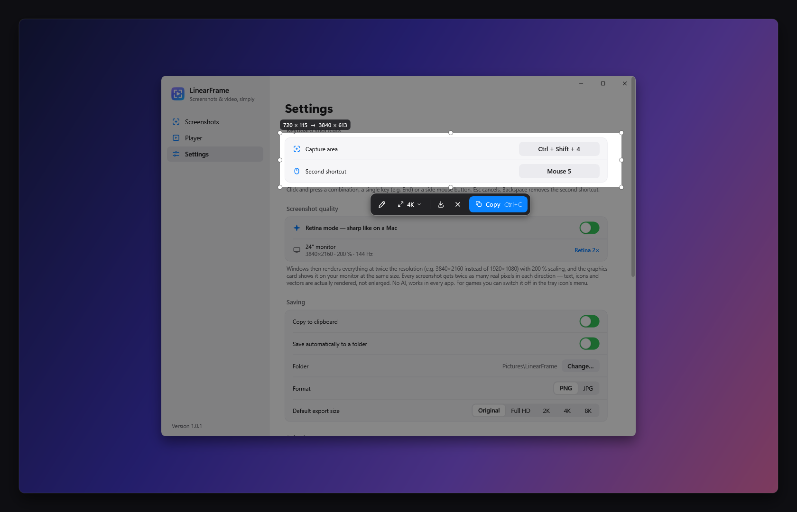
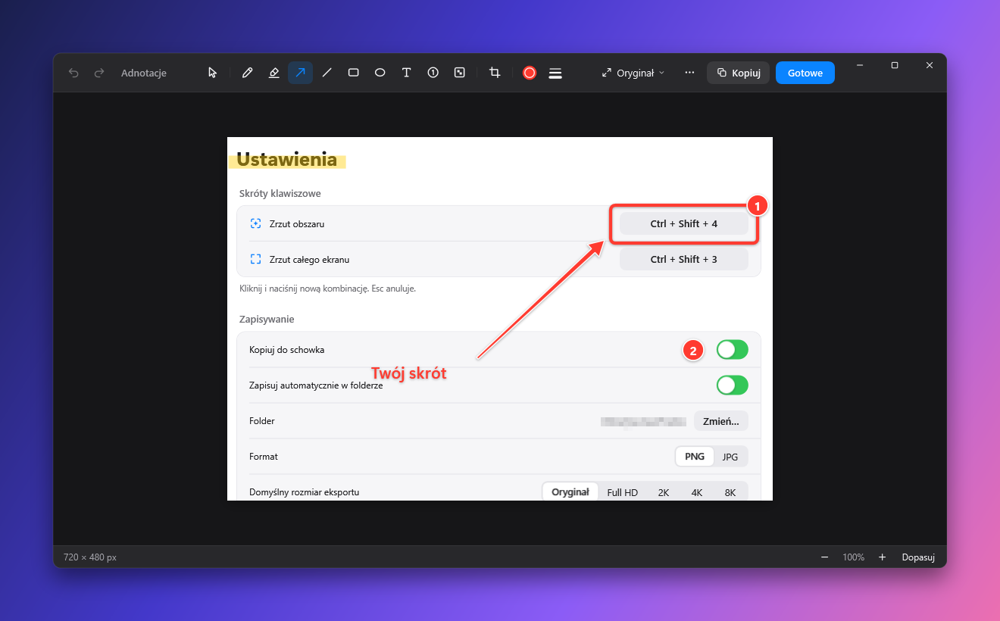
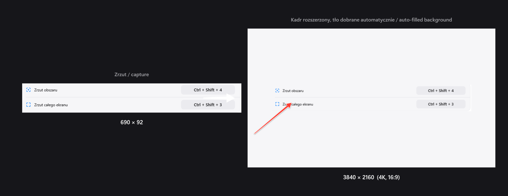
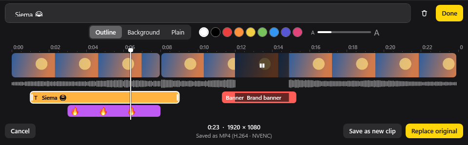
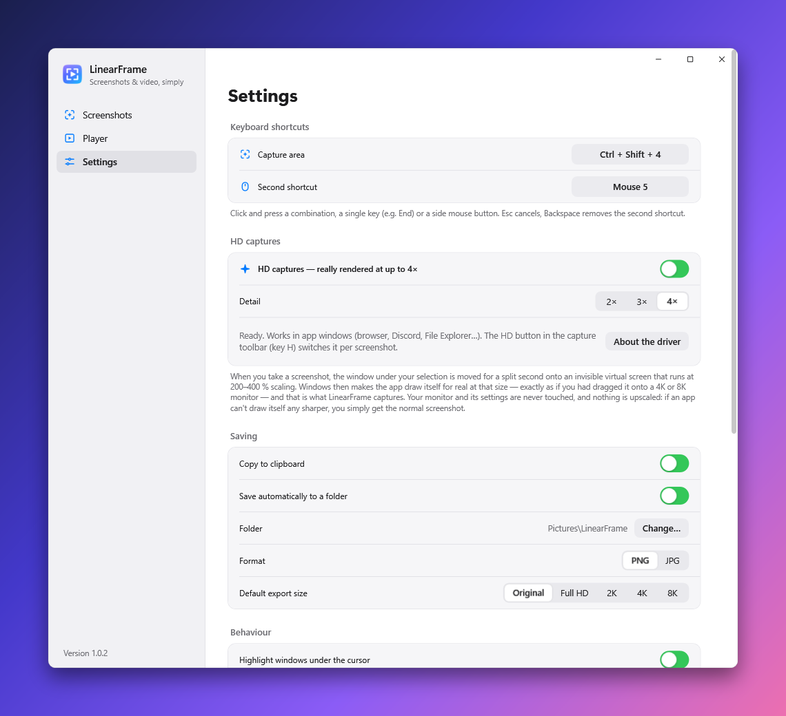
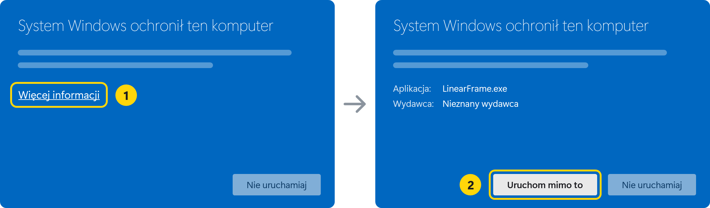
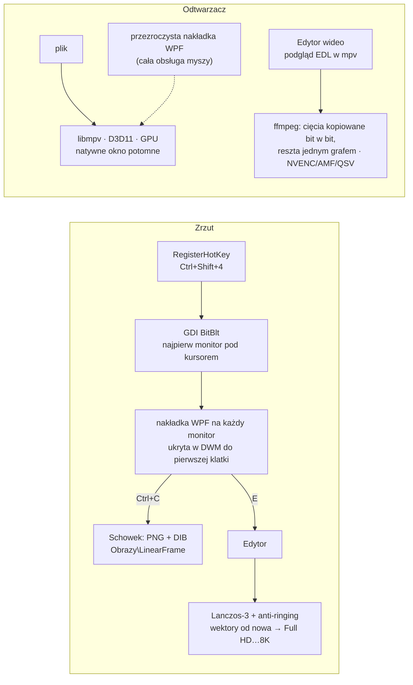

<p align="center">
  
</p>

<h1 align="center">LinearFrame</h1>

<p align="center">
  <b>Zrzuty ekranu, odtwarzacz praktycznie każdego formatu i szybki edytor wideo — dla Windows.</b><br>
  Lekki, szybki, cichy w zasobniku. Prosty i dopracowany jak macOS.
</p>

<p align="center">
  <a href="https://github.com/striktooo/LinearFrame/releases/latest"></a>
  
  <a href="LICENSE"></a>
</p>

<p align="center">
  <a href="README.md">🇬🇧 English</a> ·
  <a href="#pobieranie">Pobieranie</a> ·
  <a href="#co-potrafi">Co potrafi</a> ·
  <a href="#jak-to-działa-od-środka">Technikalia</a>
</p>



---

## Co potrafi

### 📸 Zrzuty jak ⌘⇧4 na Macu
Naciskasz **Ctrl + Shift + 4**: ekran zamarza i lekko przyciemnia się. **Przeciągasz** myszką po tym, co chcesz, albo po prostu
**klikasz okno**, żeby złapać dokładnie to okno. **Ctrl + C** (albo Enter) — zrzut jest w schowku *i* zapisany jako PNG w
`Obrazy\LinearFrame`. W rogu wysuwa się miniaturka: kliknięcie otwiera edytor, a przeciągnięcie wrzuca plik prosto do czatu czy maila.

- Skrót ustawiasz, jak chcesz: kombinacja, **jeden klawisz** (End, F13, PrintScreen…) albo **boczny przycisk myszy**
  (Mysz 4 / Mysz 5) — plus opcjonalny drugi skrót. Kliknięcie pustego pulpitu łapie cały monitor.
- Rozmiar wybierasz od razu na pasku: **Oryginał, Full HD, 2K, 4K albo 8K**.
- **Ctrl + C + C** (C dwa razy, z wciśniętym Ctrl) *dokłada* zrzut do tych, które już są w schowku — do 10 — i jedno Ctrl+V
  wkleja wszystkie naraz do czatu, maila albo folderu. Zwykłe Ctrl+C jak zawsze zastępuje schowek, a **Ctrl+Shift+Backspace**
  (albo Twój skrót) go czyści.
- **T** (albo przycisk z tekstem) kopiuje **tekst** z zaznaczenia zamiast obrazka — bez internetu, z polskimi znakami.
  **Kod QR** w zaznaczeniu dostaje przycisk, który otwiera jego link (także potem na miniaturce).
- Wiele monitorów i różne skalowania (DPI); prawdziwe, fizyczne piksele. Strzałkami przesuwasz zaznaczenie co piksel.

### ✨ Zrzuty HD — naprawdę wyrenderowane nawet w 4×, nigdy powiększane
Zwykły zrzut zawiera dokładnie te piksele, które są na ekranie — po przybliżeniu małego przycisku widać kwadraty.
Z włączonymi **zrzutami HD** LinearFrame renderuje zaznaczenie od nowa: okno spod zaznaczenia trafia na ułamek sekundy na
niewidoczny, *wirtualny ekran* ze skalowaniem 200–400 %. Windows każe wtedy aplikacji narysować się dla tego skalowania —
dokładnie tak, jak po przeciągnięciu okna na monitor 4K albo 8K — LinearFrame zapisuje ten obraz i odstawia okno na miejsce.
Wszystko to zasłania zamrożona nakładka; Twój prawdziwy monitor, jego rozdzielczość i skalowanie nie są ruszane.

- Tekst, ikony i wektorowy interfejs wychodzą w **2×, 3× albo 4× większej liczbie pikseli na bok**, narysowane przez samą
  aplikację. Bez AI i bez powiększania.
- Uczciwie: LinearFrame sprawdza, czy nowy obraz pokazuje to samo *i* czy naprawdę ma więcej szczegółów. Tam, gdzie
  aplikacja tego nie potrafi (pulpit i pasek zadań, stare programy bez obsługi HiDPI, klatki wideo), dostajesz zwykły zrzut,
  a podgląd mówi dlaczego.
- Jednorazowe włączenie w *Ustawienia → Zrzuty HD*: mały, otwarty sterownik wirtualnego ekranu
  ([Virtual Display Driver](https://github.com/VirtualDrivers/Virtual-Display-Driver), MIT) jest pobierany, sprawdzany
  i instalowany — Windows prosi o potwierdzenie. Wirtualny ekran jest podłączany tylko na czas renderowania zrzutu.

### ✏️ Adnotacje i kadr, który rośnie


Strzałki, zakreślacz, pióro, tekst, numerowane kroki i **zamazywanie** prywatnych rzeczy.
**Tekst** to te same napisy co w edytorze wideo: TikTok Sans z obrysem, tłem albo bez, biały, czarny albo dowolny kolor
z palety i emotki z iPhone'a; rozmiar zmieniasz za róg — linijki zostają takie, jak je napisałeś.
Każdy element da się potem przesunąć, powiększyć i przemalować; cofanie bez limitu.

**Kadruj i rozszerz** to coś, czego nie ma gdzie indziej: ciągniesz ramkę *na zewnątrz*, a LinearFrame rozpoznaje kolor tła
zrzutu i dopełnia nim nowe miejsce — bez szwów. Jedno kliknięcie i masz **16:9, 4:3, 1:1 albo 9:16** z równym marginesem, więc
dwa napisy z szarego interfejsu zamieniają się w czysty slajd 4K:



### 🎬 Odtwarzacz praktycznie wszystkiego


MP4, MOV/HEVC z iPhone'a, MKV, WebM, AVI, FLV, TS, AV1, VP9… i muzyka — MP3, FLAC, M4A, WAV, OGG, Opus. Dekodowanie na karcie
graficznej, kontrolki w stylu QuickTime znikające w trakcie oglądania, okno trzymające proporcje filmu, ścieżki audio i napisy,
**kopiowanie albo zapisywanie klatki** z ekranu. Muzyka od razu pokazuje okładkę i **cały utwór jako waveform** — klikasz albo
przeciągasz po nim, żeby przeskoczyć; okładka, tytuł i waveform rosną razem z oknem.

### 🖼️ Także zdjęcia
JPG, PNG, HEIC, WebP… otwarte w LinearFrame trafiają do czystej przeglądarki: dopasowane do okna (nigdy rozciągnięte ponad 100 %),
kółko powiększa tam, gdzie jest kursor, przeciąganiem się rozglądasz, dwuklik pokazuje rzeczywiste piksele. Zdjęcia z telefonu
stoją jak trzeba, kopia wielkości ekranu pojawia się od razu, a każdy piksel jest dekodowany dopiero przy powiększeniu.
**← →** przechodzą po folderze, **Edytuj** otwiera edytor adnotacji.

**Tekst na żywo**, jak w iPhonie: tekst na zdjęciu jest rozpoznawany w tle — nad nim kursor zmienia się w kreskę, przeciąganiem
zaznaczasz słowa (dwuklik bierze całą linię), **Ctrl+C** je kopiuje, a przycisk z tekstem kopiuje wszystko. Kod QR na zdjęciu
dostaje przycisk, który otwiera jego link. Wyraźne pismo odręczne też się czyta; bazgroły — niekoniecznie.

Rozpoznawanie tekstu to dwa silniki naraz, w pełni offline: ekran czyta OCR wbudowany w Windows (szybki i zna polskie znaki),
a **zdjęcia** — etykietę paczki, kartkę pod kątem, tekst na pstrokatym tle, numer wydrukowany pionowo przy kodzie kreskowym —
**PaddleOCR PP-OCRv5**: znajduje każdą linię pod dowolnym kątem, prostuje ją i czyta razem z silnikiem Windows; dla każdej linii
wygrywa lepszy odczyt, a polskie znaki, które gubi model ze zdjęć, wracają ze słownika ortograficznego Windows.

### ✂️ Edytor wideo — cięcie, napisy, warstwy, zdjęcia, baner, dowolny format


Klikasz ✂️ na pasku sterowania (albo **E**) i pod filmem otwiera się edytor z paskiem klatek i waveformem:

- **Podziel** w miejscu znacznika i **Usuń** kawałki — wytniesz dowolnie wiele fragmentów. **Połącz** dokleja kolejny film na końcu.
- **Tekst** — napisy czcionką TikToka (TikTok Sans): domyślnie biały z czarnym obrysem, albo z tłem, albo bez niczego;
  dowolny rozmiar; przeciągasz je po filmie (same łapią środek), dwuklik = edycja tekstu. Kolor: **biały**, **czarny** albo
  **kolorowe kółko** — otwiera paletę ze wszystkimi kolorami, napis zmienia się razem z ruchem myszy, a pod spodem czekają
  ostatnio używane kolory. Zaznacz najpierw kawałek tekstu, a pokoloruje się tylko zaznaczenie. **Aa** przełącza na własną
  czcionkę: pliki `.ttf` / `.otf` importujesz raz i zostają na liście.
- **Warstwy** — zduplikuj film (**Format** → przycisk kopii albo **Ctrl+D**, gdy nic nie jest zaznaczone), a ten sam film
  pojawi się jeszcze raz, we własnej ramce i z własnym przybliżeniem. Ze streama 16:9 robisz klip 9:16
  z kamerką na górnej połowie i grą na dolnej: pierwsza warstwa dzieli kadr z filmem na dwie połowy (obie wypełnione), potem
  kółko myszy przybliża w miejscu kursora (do 24×, wystarczy na małą kamerkę w rogu), a przeciąganie przesuwa film w ramce.
  Uchwyty ramki zmieniają, jaką część kadru zajmuje warstwa, gałka pod jej górną krawędzią przesuwa całą warstwę; ramki
  łapią krawędzie, środek i siebie nawzajem. Każda warstwa ma swój pasek na osi czasu i może być widoczna tylko przez
  część filmu.
- **Zdjęcie** — wstawia na film zdjęcie (logo, mem, fotkę): przesuwasz, zmieniasz rozmiar, przycinasz jego pasek na osi czasu.
- **Duplikuj** (Ctrl+D) robi drugi egzemplarz tego, co zaznaczone — warstwy, zdjęcia, napisu, emotki; **Odbij lustrzanie**
  odwraca warstwę, sam film, zdjęcie albo emotkę.
- **Pasy pod paskiem klatek to stos tego, co leży na filmie**: górny pas jest na wierzchu. Baner zawsze na samej górze, pod nim
  napisy i zdjęcia, na dole warstwy wideo. Przeciągnij pasek w górę albo w dół, a pójdzie przed albo za pozostałe — w bok
  przesuwa się w czasie, jak dotąd.
- **Emotki** — buźka obok napisu otwiera prawdziwą galerię emotek z iPhone'a (grafiki Apple pobierane raz): najpierw ostatnio
  używane, do tego wyszukiwarka po polsku i angielsku („serce”, „ogień”, „fire”…). Napis z samej emotki to naklejka.
- **Baner** — wstawia Twój baner (film z przezroczystością, np. ProRes 4444 .mov) w miejscu znacznika: film gra jeszcze 0,7 s,
  potem stoi, póki baner leci, i rusza 0,4 s przed końcem banera. Przesuwasz go po filmie albo na osi czasu, zmieniasz rozmiar,
  **Góra / Środek / Dół**. Prawy klik na przycisku = inny plik banera.
- **Format** — 9:16, 1:1, 4:5, 16:9 albo oryginał; dopasuj albo wypełnij, powiększ i przesuń film w kadrze, tło rozmyte albo
  czarne, rozdzielczość.

Podgląd gra na żywo w odtwarzaczu (kadr robi karta graficzna, baner leci we własnej warstwie; przy warstwach wideo kadr rysuje
ten sam graf filtrów, który potem robi plik), wszystko z cofaniem i ponawianiem.
**Zapisz jako nowy klip** albo **Zastąp oryginał** (oryginał trafia do Kosza): samo cięcie jednego pliku jest kopiowane bit w bit
— bez utraty jakości, w kilka sekund nawet dla 4 GB; wszystko inne jest raz renderowane do MP4 (H.264), na karcie graficznej,
jeśli jest (NVIDIA, AMD, Intel), co do klatki, z dźwiękiem banera.

### 📚 Biblioteka, ustawienia i ciche aktualizacje
| | |
|---|---|
|  |  |

LinearFrame siedzi w zasobniku i zużywa **0 % CPU**. Nowe wersje pobierają się w tle, są sprawdzane (SHA-256) i instalują się
**wtedy, gdy nie korzystasz z aplikacji** — bez instalatora, bez uprawnień administratora i bez żadnego serwera: aktualizacje
przychodzą prosto z zakładki Releases tego repozytorium. Aktualizacja pobiera zwykle tylko samą aplikację (kilka MB); .NET
i silniki są pobierane ponownie tylko wtedy, gdy naprawdę się zmieniły.

---

## Pobieranie

1. Pobierz **`LinearFrame-x.y.z-win-x64.zip`** z [**Releases**](https://github.com/striktooo/LinearFrame/releases/latest).
2. Najpierw rozpakuj cały folder (prawy przycisk → *Wyodrębnij wszystkie*; prosto z ZIP-a aplikacja się nie uruchomi),
   potem uruchom **`LinearFrame.exe`**. Nic nie instalujesz — .NET, na którym działa, jest w folderze.
3. **Za pierwszym razem Windows pokaże niebieskie okno „System Windows ochronił ten komputer”. Kliknij *Więcej informacji*,
   a potem *Uruchom mimo to*.**



<details>
<summary><b>Dlaczego Windows ostrzega — i czy to bezpieczne?</b></summary>

LinearFrame nie ma jeszcze podpisu cyfrowego. Filtr Microsoft Defender SmartScreen pokazuje to okno przy każdym programie
bez podpisu, dopóki dokładnie tego pliku nie uruchomi dość dużo osób — a dla programu bez podpisu licznik zaczyna się od
zera przy każdej wersji ([opis Microsoftu](https://learn.microsoft.com/windows/apps/package-and-deploy/smartscreen-reputation)).
To znaczy „nie znamy jeszcze tego pliku”, a nie „znaleziono wirusa”: antywirus Defendera skanuje paczkę jak każdy pobrany
plik i niczego nie znajduje (każde wydanie jest tak sprawdzane przed publikacją).

- Okno pojawia się **raz**. Kolejne wersje instalują się same z poziomu aplikacji i już go nie pokazują.
- Każde wydanie jest zbudowane ze źródeł z tego repozytorium, a każdy ZIP ma swoją sumę SHA-256.
- Na komputerach z włączoną **Inteligentną kontrolą aplikacji** (wiele nowych komputerów z Windows 11) przycisku
  *Uruchom mimo to* nie ma: Windows pozwala wystartować `LinearFrame.exe`, po czym blokuje niepodpisany plik
  `LinearFrame.dll` i aplikacja zamyka się bez okna (w dzienniku zdarzeń: *Zasady kontroli aplikacji zablokowały ten
  plik*, 0x800711C7). Windows nie daje wyjątku dla jednej aplikacji, więc na takim komputerze LinearFrame zadziała
  dopiero z podpisem. Podpis cyfrowy jest w planach.
</details>

<details>
<summary><b>Odinstalowanie</b></summary>

Ustawienia → wyłącz *Uruchamiaj razem z Windows* (oraz *Zrzuty HD → Usuń sterownik*, jeśli go instalowałeś), zakończ
aplikację (ikonka w zasobniku → *Zakończ*), usuń folder i skrót *LinearFrame* z menu Start. Jeśli LinearFrame był domyślną
aplikacją do filmów, muzyki albo zdjęć, wybierz inną w Ustawieniach Windows → Aplikacje domyślne. Ustawienia są
w `%APPDATA%\LinearFrame`, logi i pamięć podręczna w `%LOCALAPPDATA%\LinearFrame`, a zrzuty w `Obrazy\LinearFrame`.
</details>

Aplikacja startuje od razu po zalogowaniu do Windows — przez małe zadanie użytkownika w Harmonogramie zadań, bez uprawnień
administratora (programy z klasycznej listy „Uruchom” Windows wstrzymuje o 20–30 s); wyłączysz to w Ustawieniach. Żeby otwierała filmy, muzykę albo zdjęcia domyślnie: *Odtwarzacz →
Otwieraj wideo, muzykę i zdjęcia w LinearFrame*; każdy format dostaje wtedy własną, płaską ikonkę — niebieski film, różowa nuta,
zielony obrazek, z nazwą formatu — więc w folderze od razu widać, co jest czym; pliki wideo mają też **Edytuj w LinearFrame**
w klasycznym menu kontekstowym.

## Skróty

| Gdzie | Klawisze |
|---|---|
| Wszędzie | **Ctrl+Shift+4** zrzut (albo Twój klawisz / przycisk myszy) · **Ctrl+Shift+Backspace** wyczyść schowek |
| Przy zaznaczaniu | **Ctrl+C / Enter** kopiuj i zapisz · **Ctrl+C+C** dołóż do schowka · **T** kopiuj tekst · **E** edytuj · **Ctrl+S** zapisz jako · **Esc** anuluj · **strzałki** przesuń · prawy klik czyści |
| Edytor | **V P H A T N B** narzędzia · **C** kadruj i rozszerz · **Ctrl+Z / Ctrl+Shift+Z** · **Ctrl+C** kopiuj · **Ctrl+S** gotowe |
| Odtwarzacz | **Spacja** pauza · **← →** 5 s · **J L** 10 s · **, .** klatka · **↑ ↓** głośność · **M** wycisz · **F** pełny ekran · **Ctrl+C** kopiuj klatkę · **E** edytor wideo |
| Edytor wideo | **Spacja** odtwórz · **← →** klatka (**Shift** 1 s) · **S** podziel · **Delete** usuń · **T** tekst · **I** zdjęcie · **Ctrl+D** duplikuj (nic nie zaznaczone: film, jako warstwę) · **Ctrl+Z / Ctrl+Y** · **Esc** gotowe / wyjdź |
| Zdjęcia | **← →** poprzednie / następne · **kółko** powiększenie · **dwuklik**, **0 / 1** cały obraz / rzeczywiste piksele · **Ctrl+C** kopiuj (najpierw zaznaczony tekst) · **Ctrl+A** zaznacz cały tekst · **E** edytuj · **Esc** zamknij |

Wiersz poleceń: `LinearFrame.exe film.mp4` · `--trim film.mp4` · `--cut film.mp4` · `--capture` · `--settings` · `--exit`

---

## Jak to działa od środka

Jedna aplikacja C# / .NET 10 WPF z ręcznie zrobionym motywem w stylu macOS (jasny i ciemny), rozmawiająca bezpośrednio z Win32,
plus sprawdzone silniki obok pliku exe: **mpv** do odtwarzania, **FFmpeg** do edycji i **ONNX Runtime** z modelami
PaddleOCR PP-OCRv5 do czytania tekstu na zdjęciach.



<details>
<summary><b>Zrzuty</b></summary>

- Skróty przez `RegisterHotKey` na ukrytym oknie — zero odpytywania, zero CPU w oczekiwaniu. Boczne przyciski myszy wymagają haka
  `WH_MOUSE_LL`; istnieje on tylko wtedy, gdy przypiszesz przycisk myszy, działa w osobnym wątku (mysz nigdy nie czeka na interfejs)
  i połyka wyłącznie to jedno kliknięcie.
- Najpierw zrzucany jest monitor pod kursorem (GDI `BitBlt` skomponowanego pulpitu, ok. 30 ms dla 1080p) i od razu pokazuje się
  jego nakładka; pozostałe monitory dochodzą chwilę później. Okna nakładki powstają jako „ukryte w DWM” (cloak) i odsłaniają się
  dopiero po namalowaniu pierwszej klatki — bez mignięcia. Po starcie w rogu każdego monitora rysuje się malutka, ukryta
  i przezroczysta dla myszy nakładka, więc kod nakładki i urządzenie Direct3D WPF-a dla każdego ekranu są gotowe, zanim
  naciśniesz skrót (ponownie po zmianie ekranów i po wybudzeniu) — już pierwszy zrzut jest tak szybki jak kolejne.
- Klikanie okien: `EnumWindows` + `DWMWA_EXTENDED_FRAME_BOUNDS` (prawdziwe granice bez niewidzialnej ramki), z pominięciem okien
  ukrytych, przezroczystych dla myszy i nakładek typu overlay.
- Wszystko w fizycznych pikselach; WPF działa w trybie Per-Monitor-V2 DPI.
</details>

<details>
<summary><b>Start: nic nie ładuje się dopiero wtedy, gdy tego potrzebujesz</b></summary>

- LinearFrame startuje przy logowaniu i kilka sekund później robi wszystko raz „na sucho”, **poza zasięgiem wzroku**: rysuje
  nakładkę zrzutu na każdym monitorze, ładuje libmpv i FFmpeg, w oknie odtwarzacza puszcza sekundowy, niemy klip (wyjście
  wideo, dekoder sprzętowy, shadery), a w przeglądarce otwiera mały obrazek — w oknach ukrytych w DWM, które nigdy nie
  przejmują fokusu, i nigdy wtedy, gdy ekran zajmuje gra albo film. Pierwszy zrzut, film czy zdjęcie po restarcie jest dzięki
  temu tak szybkie jak dziesiąte.
- `LinearFrame.exe` to mały program startowy (0,2 MB) obok `LinearFrame.dll`, działający na własnej kopii .NET w folderze
  `runtime` (`AppHostRelativeDotNet` — nic nie instalujesz, a exe nigdzie indziej nie szuka). Do wersji 1.2.0 był to jeden
  samowystarczalny plik exe o rozmiarze 146 MB i to przez niego pierwszy zrzut po restarcie czekał kilka sekund: antywirus
  czyta taki plik od początku do końca przy pierwszym dotknięciu po restarcie i po każdej aktualizacji swoich definicji
  (Microsoft Defender: ok. 4 s dla tego pliku) — a ten plik jest dotykany bez przerwy: WPF pyta go o ikonę przy tworzeniu
  każdego okna (`ExtractIconEx`), a otwarcie pliku w LinearFrame uruchamia exe jeszcze raz. Mały exe czyta się w mgnieniu
  oka; biblioteki są sprawdzane raz, przy ładowaniu.
- Drugie uruchomienie (plik otwarty z Eksploratora) sprawdza tylko blokadę działającej kopii i przekazuje jej wiersz
  poleceń przez `WM_COPYDATA`, zanim załaduje się jakakolwiek biblioteka interfejsu — ok. 0,1 s.
</details>

<details>
<summary><b>Zrzuty HD</b></summary>

- Płótnem jest wirtualny monitor (IddCx) z otwartego sterownika Virtual Display Driver. W spoczynku jest odłączony od
  pulpitu (`ChangeDisplaySettingsEx` z zerowym rozmiarem); na czas zrzutu podłączany w 3840×2160 … 7680×4320 ze skalowaniem
  200–400 % (`DisplayConfigSetDeviceInfo` — to samo wywołanie, którego używają Ustawienia Windows). Po instalacji bez uprawnień administratora.
- Okno, do którego należy zaznaczenie, pochodzi z listy okien zapamiętanej w chwili zamrożenia ekranu. Jest przenoszone przez
  `SetWindowPos(SWP_ASYNCWINDOWPOS)`; Windows wysyła mu `WM_DPICHANGED`, aplikacja układa się w tym samym rozmiarze logicznym
  z N× większą liczbą pikseli, a potem okno wraca dokładnie w ten sam prostokąt.
- Wirtualny ekran jest czytany przez `BitBlt`, aż obraz się ustabilizuje, a potem sprawdzany względem zamrożonego zrzutu 1×:
  dopasowanie położenia (najlepsze przesunięcie w ±14 px na rozmytej skali szarości), podobieństwo struktury (znormalizowana
  korelacja) i test *zysku szczegółów* — prawdziwy render N× ma około N razy więcej energii krawędzi niż ten sam obraz
  jedynie rozciągnięty (zmierzone: 3,8 dla prawdziwego 4×, 0,75 dla rozciągniętego). Rozciągnięta albo zmieniona treść jest
  odrzucana i używany jest zwykły zrzut — wynik nigdy nie jest rozmytym powiększeniem.
- Duże zaznaczenia renderowane są w mniejszej krotności (całe okno w 4× to obraz 30 megapikseli).
- Instalacja: paczka sterownika pochodzi z jego wydania na GitHubie, jest sprawdzana przypiętą sumą SHA-256 i instalowana
  przez podniesioną kopię aplikacji przez SetupAPI (to samo, co robi `devcon install`).
</details>

<details>
<summary><b>Edytor i eksport</b></summary>

- Nieniszczący dokument: oryginalne piksele + prostokąt *kadru* (przycięcie albo rozszerzenie, może wychodzić poza obraz)
  + adnotacje wektorowe.
- **Wykrywanie tła**: dominujący kolor dwupikselowej obwódki obrazu (histogram 5-bitowy) wypełnia rozszerzony kadr.
- **Eksport**: widoczna część zrzutu jest skalowana separowalnym, wielowątkowym filtrem **Lanczos-3** z **anti-ringingiem**
  (bez obwódek przy krawędziach interfejsu), a każda adnotacja jest rysowana od nowa jako wektor w docelowej rozdzielczości —
  strzałki i tekst są ostre nawet w 8K. Kadr 16:9 trafia dokładnie w 1920×1080 / 2560×1440 / 3840×2160 / 7680×4320.
- Do schowka trafia strumień PNG (z przezroczystością — przeglądarki, Discord, Slack, Office) oraz klasyczna bitmapa DIB.
</details>

<details>
<summary><b>Odtwarzacz</b></summary>

- **libmpv** rysuje w natywnym oknie potomnym z własnym łańcuchem D3D11 i dekodowaniem sprzętowym (`hwdec=auto-safe`,
  np. d3d11va) — najpłynniejsza droga w Windows.
- Kontrolki są w osobnym, przezroczystym oknie WPF leżącym dokładnie nad filmem i przejmującym całą obsługę myszy (także krawędzie
  do zmiany rozmiaru). W trakcie oglądania mpv przestaje informować interfejs o pozycji, więc wątek UI śpi.
- Zdarzenia mpv są czytane w wątku w tle i łączone w najwyżej ~8 aktualizacji interfejsu na sekundę.
</details>

<details>
<summary><b>Edytor wideo</b></summary>

- Trzy osie czasu: klipy sklejone jeden za drugim (tu są zakotwiczone napisy i banery, więc zostają przy „swoim” momencie, gdy
  coś przed nimi wytniesz), zostawione kawałki (to mpv gra jako jedna oś EDL) i gotowy film (plus pauzy banerów). Pauza to mpv
  zatrzymujący się sam na dokładnej klatce (sprawdzane w wątku zdarzeń mpv), a w tym czasie biegnie zegar.
- Podgląd formatu: mpv rysuje tylko w tej części kadru, którą zajmuje film, a `video-zoom`/`video-pan` stawiają obraz tam,
  gdzie jest — robi to karta graficzna, więc odtwarzanie jest tak samo płynne jak bez formatu. Rozmyte tło to warstwa WPF pod spodem.
- Warstwy wideo: kadr składa jeden graf filtrów FFmpeg (`EditGraph`) — tło (czarne albo rozmyta kopia filmu) i każda warstwa
  wycięta z klatki, *zanim* zostanie przeskalowana (crop → scale → dokładny crop), więc kamerka przybliżona dwadzieścia razy
  kosztuje tyle, co mały kawałek obrazu, którym jest. Ten sam graf, w rozmiarze, jaki kadr ma na ekranie, działa w mpv jako
  filtr `lavfi` (dekoder oddaje mu klatki w pamięci) — to, co widać, to to, co się zapisze. Zatrzymany mpv potrzebuje
  80–250 ms na każdą zmianę (dekoduje klatkę od nowa), za wolno dla ręki: podczas przeciągania warstwy edytor sam rysuje
  warstwy z klatki spod znacznika, przy każdym ruchu myszy, a mpv dogania pod spodem.
- Podgląd banera to przezroczyste dla myszy okno warstwowe, do którego trafiają klatki dekodowane przez FFmpeg na bieżąco,
  dokładnie w pokazywanym rozmiarze, do krótkiej kolejki (kilka klatek, niezależnie od wielkości okna).
- **Kopia** (samo cięcie jednego pliku): jeden kawałek = `ffmpeg -ss -t -c copy` (MP4/MOV zaczynają się co do klatki dzięki
  liście edycji); kilka kawałków = demultiplekser concat czytający punkty wejścia/wyjścia z pliku (każdy kolejny kawałek zaczyna
  się od klatki kluczowej, znalezionej bez dekodowania przez `-c copy -f framecrc`). Przy klatkach B takie łączenia nie są
  dokładne co do klatki, więc wtedy film jest renderowany.
- **Render**: jeden graf filtrów FFmpeg — każdy klip dekodowany raz, cięcia co do klatki, każda pauza czytana przez osobne
  wejście i trzymana `tpad`, każdy kawałek wpasowany w kadr (scale/crop/pad albo rozmyta kopia), baner przycięty do obszaru,
  w którym naprawdę jest na swoim płótnie (znalezionego raz przez `alphaextract,bbox`), napisy i emotki jako obrazki z tego
  samego kodu rysującego co podgląd, dźwięk sklejony z ciszą w pauzach i zmiksowany z dźwiękiem banera.
  Koder: NVENC → AMF → QSV → x264.
- *Zastąp oryginał* zatrzymuje odtwarzanie, przenosi oryginał do Kosza i przywraca daty pliku.
</details>

<details>
<summary><b>Automatyczne aktualizacje (bez serwera)</b></summary>

1. Dwa razy dziennie: `GET api.github.com/repos/striktooo/LinearFrame/releases/latest` (tylko numer wersji — zero telemetrii).
2. Nowsza wersja → pobranie najmniejszej paczki, która pasuje do zainstalowanej kopii, i sprawdzenie jej z opublikowanym
   `.sha256`: `-app.zip` (tylko pliki samej aplikacji, kilka MB), `-update.zip` (aplikacja i jej .NET) albo pełna
   `-win-x64.zip`. Plik `.sha256` mniejszej paczki wymienia też pliki, które mają już być zainstalowane (silniki, .NET),
   z ich sumami kontrolnymi — kopia, która ma dokładnie takie, bierze tę paczkę, każda inna bierze następną, większą.
3. Gdy nic nie jest otwarte, pliki są podmieniane w miejscu: Windows pozwala *zmienić nazwę* działającego exe/DLL, więc stare stają
   się `*.old`, nowe są kopiowane, a aplikacja sama się restartuje (z wycofaniem zmian, jeśli coś pójdzie nie tak).
4. Nowa instancja sprząta (stare pliki, zastąpioną wersję .NET). Zabezpieczenie wersji chroni przed zapętleniem. Można to
   wyłączyć w Ustawieniach.
</details>

<details>
<summary><b>Zmierzona wydajność</b> (Ryzen 7 5800X, RTX 4070, Windows 11, trzy monitory 1080p)</summary>

| Scenariusz | Wynik |
|---|---|
| Bezczynność w zasobniku | **0 % CPU**, ~7 MB pamięci roboczej |
| Ctrl+Shift+4 → nakładka na ekranie | **~75–130 ms** (monitor pod kursorem), ~250 ms wszystkie trzy |
| Pierwszy film po restarcie | okno z pierwszym obrazem po **~0,2 s** — jak każdy kolejny |
| Plik otwarty z Eksploratora | ~0,1 s, zanim dostanie go działająca aplikacja |
| Odtwarzanie 1080p30 H.264, ukryte kontrolki | **~0,6 % całego CPU** (≈10 % jednego rdzenia, dekodowanie sprzętowe) |
| Bezstratne wycięcie fragmentu z klipu 10 s | ~2–3 s, czyste dekodowanie |
| Zrzut 520×300 → eksport 8K | ~2,4 s skalowanie + ~2 s PNG |
</details>

<details>
<summary><b>Prywatność</b></summary>

Bez kont, telemetrii i analityki — nic o Tobie ani o Twoich plikach nie jest nigdzie wysyłane. LinearFrame łączy się
z internetem tylko w trzech sprawach: sprawdzenie aktualizacji w zakładce Releases tego repozytorium i jej pobranie (można
to wyłączyć); obrazki emotek, pobierane raz z jsDelivr przy pierwszym otwarciu galerii emotek; oraz sterownik wirtualnego
ekranu, pobierany z jego repozytorium na GitHubie, gdy włączasz zrzuty HD. Zrzuty nigdy nie opuszczają komputera, chyba że
sam je wyślesz.
</details>

---

## Budowanie ze źródeł

Potrzebujesz Windows 10/11 i [.NET 10 SDK](https://dotnet.microsoft.com/download).

```powershell
git clone https://github.com/striktooo/LinearFrame
cd LinearFrame
pwsh scripts/fetch-deps.ps1            # pobiera libmpv + ffmpeg do ./deps
dotnet run --project src/LinearFrame   # uruchomienie
pwsh ./build.ps1                       # dist/LinearFrame-<wersja>-win-x64.zip
```

Wydania buduje GitHub Actions: wypchnięcie tagu `vX.Y.Z` → workflow buduje ZIP i go publikuje, a zainstalowane kopie
aktualizują się same w ciągu pół dnia. Instrukcja krok po kroku: [docs/GITHUB_PL.md](docs/GITHUB_PL.md).

## Pomysły na później

Skalowanie AI (Real-ESRGAN przez DirectML) · przewijane zrzuty długich stron · nagrywanie ekranu do MP4/GIF ·
przypinanie zrzutu nad wszystkimi oknami · podpis cyfrowy.

## Licencja

Kod LinearFrame jest na licencji **MIT** — zobacz [LICENSE](LICENSE). Paczka do pobrania zawiera też mpv i FFmpeg (GPL);
szczegóły w [THIRD-PARTY-NOTICES.md](THIRD-PARTY-NOTICES.md). Zrobione z sercem w Polsce 🇵🇱.
